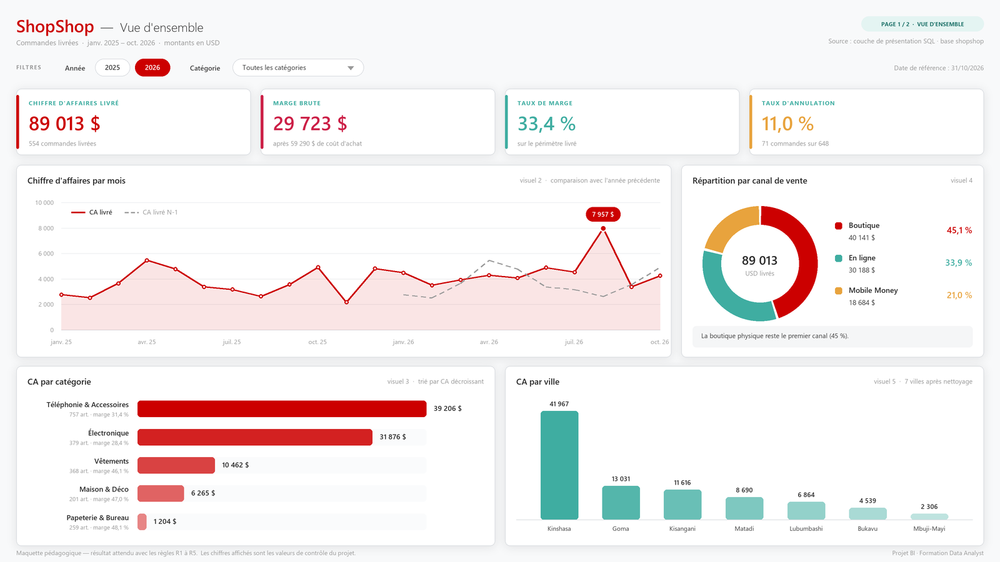
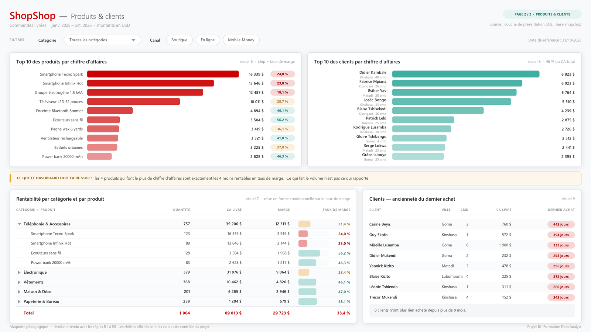

# 🛒 Projet BI — ShopShop

**Version simplifiée, pour débutants en data analyse.**
PostgreSQL + Power BI Desktop · 8 heures · 1 dashboard de 2 pages.

Vous reprenez la base de ventes d'une boutique congolaise, vous l'auditez, vous
construisez la couche SQL propre qui servira de source unique de vérité, et vous
livrez le dashboard que la direction consultera sans vous appeler.

---

## 🎯 À quoi ressemble le livrable

Voilà ce que vous allez construire. Les chiffres affichés sont les **vraies valeurs**
de la base : si votre dashboard affiche la même chose, c'est qu'il est juste.





> 📐 Ce sont des **maquettes de référence**, pas une maquette au pixel près à
> reproduire. La mise en page, les couleurs exactes et les visuels supplémentaires
> restent vos décisions — voir [le brief](docs/1_ENONCE.md#7-le-dashboard--9-visuels-2-pages).

---

## 🚦 Par où commencer

| Ordre | Fichier | Ce que vous y trouvez |
|---|---|---|
| **1** | [Installation](#-installation-20-minutes) (juste en dessous) | monter la base, 20 min |
| **2** | 📝 [docs/1_ENONCE.md](docs/1_ENONCE.md) | **le brief** : le contexte, les règles, ce qu'on attend de vous |
| **3** | 🧭 [docs/2_GUIDE_PAS_A_PAS.md](docs/2_GUIDE_PAS_A_PAS.md) | **le mode d'emploi** : chaque étape expliquée, avec les chiffres à retrouver |
| **4** | 📖 [docs/3_GLOSSAIRE.md](docs/3_GLOSSAIRE.md) | tous les mots du projet, expliqués simplement |

> Vous êtes formateur ou formatrice ? Tout est dans [formateur/CORRIGE.md](formateur/CORRIGE.md).

---

## 🚀 Installation (20 minutes)

### Ce qu'il vous faut

- **PostgreSQL 14 ou plus** ([postgresql.org/download](https://www.postgresql.org/download/)),
  installé avec **pgAdmin** (il est coché par défaut dans l'installateur Windows).
- **Power BI Desktop** (gratuit, Microsoft Store ou
  [powerbi.microsoft.com](https://powerbi.microsoft.com/desktop/)).
- Pendant l'installation de PostgreSQL, on vous demande un mot de passe pour
  l'utilisateur `postgres`. **Notez-le**, vous en aurez besoin trois fois.

### Étape 1 — Créer la base

Dans **pgAdmin** : clic droit sur `Databases` → `Create` → `Database…` →
nom : `shopshop` → `Save`.

<details>
<summary>Ou en ligne de commande, si vous préférez</summary>

```bash
createdb -U postgres shopshop
```
</details>

### Étape 2 — Exécuter les fichiers SQL, dans cet ordre

Dans pgAdmin : sélectionnez la base `shopshop`, ouvrez le **Query Tool** (icône
en haut), puis pour chaque fichier : `Open File` (📁) → choisir le fichier →
`Execute` (▶ ou F5).

| # | Fichier | Ce qu'il fait | Durée |
|---|---|---|---|
| 1 | `sql/01_creer_la_base.sql` | crée les 5 tables (vides) | instantané |
| 2 | `sql/02_charger_les_donnees.sql` | charge 648 commandes | ~10 s |
| 3 | `sql/03_vues_du_stagiaire.sql` | crée les 3 vues à auditer | instantané |
| 4 | `sql/05_calendrier.sql` | crée le calendrier (cadeau) | instantané |

> `sql/04_boite_a_outils.sql` **ne s'exécute pas en entier** : c'est un carnet de
> requêtes dans lequel vous piochez pendant l'audit.

<details>
<summary>Ou en ligne de commande</summary>

```bash
psql -U postgres -d shopshop -f sql/01_creer_la_base.sql
```

```bash
psql -U postgres -d shopshop -f sql/02_charger_les_donnees.sql
```

```bash
psql -U postgres -d shopshop -f sql/03_vues_du_stagiaire.sql
```

```bash
psql -U postgres -d shopshop -f sql/05_calendrier.sql
```
</details>

### Étape 3 — Vérifier que tout est là

Collez ceci dans le Query Tool et exécutez :

```sql
SELECT 'clients' AS table_, COUNT(*) FROM clients
UNION ALL SELECT 'categories',      COUNT(*) FROM categories
UNION ALL SELECT 'produits',        COUNT(*) FROM produits
UNION ALL SELECT 'commandes',       COUNT(*) FROM commandes
UNION ALL SELECT 'lignes_commande', COUNT(*) FROM lignes_commande;
```

**Résultat attendu : 81 · 5 · 25 · 648 · 1289.**
Si vous obtenez exactement ces cinq nombres, votre base est bonne et vous pouvez
ouvrir [le brief](docs/1_ENONCE.md).

### Étape 4 — Connecter Power BI (plus tard, à l'étape 4 du projet)

`Obtenir les données` → `Base de données PostgreSQL` →
Serveur : `localhost`  ·  Base de données : `shopshop`  ·  Mode : **Importer**.

---

## 🩹 Si ça coince

| Message | Ce qui se passe | Quoi faire |
|---|---|---|
| `password authentication failed` | mauvais mot de passe `postgres` | celui choisi à l'installation de PostgreSQL ; en cas d'oubli, réinstaller est souvent plus rapide que réparer |
| `database "shopshop" does not exist` | l'étape 1 n'a pas été faite | créer la base avant d'exécuter les fichiers |
| `relation "commandes" does not exist` | fichiers lancés dans le désordre | relancer `01_creer_la_base.sql` puis `02_charger_les_donnees.sql` |
| `Télévlseur`, `KinshasaÂ` — caractères bizarres | problème d'encodage | dans pgAdmin : Preferences → Query Tool → vérifier `UTF-8` ; en ligne de commande, lancer `SET client_encoding TO 'UTF8';` avant |
| Power BI : `Npgsql has not been installed` | pilote PostgreSQL absent | installer le connecteur **Npgsql** puis redémarrer Power BI Desktop |
| Power BI ne voit pas le serveur | PostgreSQL est arrêté | Services Windows → `postgresql-x64-…` → Démarrer |

---

## 📁 Les fichiers du projet

```
projet_demo_bi_shopshop/
│
├── README.md                     ← vous êtes ici : installation + plan des fichiers
│
├── docs/                         ← 📚 CE QUE VOUS DEVEZ LIRE
│   ├── 1_ENONCE.md                  le brief : contexte, règles, livrables, notation
│   ├── 2_GUIDE_PAS_A_PAS.md         le mode d'emploi détaillé des 5 étapes
│   └── 3_GLOSSAIRE.md               le vocabulaire, expliqué en français simple
│
├── sql/                          ← 🗄️ CE QUE VOUS EXÉCUTEZ
│   ├── 01_creer_la_base.sql         les 5 tables
│   ├── 02_charger_les_donnees.sql   les données (défauts volontaires inclus)
│   ├── 03_vues_du_stagiaire.sql     ⚠️ les 3 vues fausses, à auditer
│   ├── 04_boite_a_outils.sql        les requêtes d'exploration et d'audit
│   └── 05_calendrier.sql            la table de dates, fournie toute faite
│
├── ressources/                   ← 🎨 POUR VOUS AIDER
│   ├── maquettes/                   📐 les 2 pages du dashboard en image
│   │   ├── page1_vue_ensemble.png
│   │   └── page2_produits_clients.png
│   ├── theme_shopshop.json          le thème Power BI aux couleurs ShopShop
│   └── modele_note_de_mission.md    le squelette de votre rendu écrit
│
└── formateur/                    ← 📕 NE PAS OUVRIR AVANT D'AVOIR FINI
    ├── CORRIGE.md
    ├── solution_couche_presentation.sql
    ├── solution_mesures_dax.md
    ├── valeurs_de_controle.txt
    └── maquettes_src/               le générateur des maquettes (Python)
```

---

## 🎯 Ce que ce projet vous apprend

| Compétence | Où elle se travaille |
|---|---|
| Auditer la qualité d'une base qu'on n'a pas écrite | Étape 2 — 5 anomalies à trouver et à décider |
| Lire du SQL existant d'un œil critique | Les 3 vues de Jonas : elles tournent, et elles mentent |
| `COALESCE`, `LEFT JOIN`, CTE, `TRIM` / `INITCAP` | Étapes 2 et 3 |
| Construire une couche de présentation SQL | Étape 3 — 3 vues à écrire |
| Modéliser en étoile dans Power BI | Étape 4 — 4 relations |
| Écrire des mesures DAX justes | Étape 4 — 13 mesures, chacune avec sa valeur de contrôle |
| Construire un dashboard lisible | Étape 5 — 9 visuels sur 2 pages |
| Restituer à des non-techniciens | Étape 6 — 3 questions, chiffres à l'appui |

**Continuité pédagogique.** Ce projet clôt la séquence
*jointures → requêtes composées → vues et industrialisation*. Les conventions des
ateliers sont reprises telles quelles : préfixe `v_`, `snake_case`, en-tête de
documentation obligatoire sur chaque vue.

---

## 🧪 Le jeu de données en deux mots

**ShopShop**, distribution multi-produits en RDC : Kinshasa, Lubumbashi, Goma,
Bukavu, Matadi, Kisangani, Mbuji-Mayi. 5 catégories, 3 canaux de vente, tout en USD,
de janvier 2025 à octobre 2026.

Les données sont **sales exprès**. Chaque défaut est là pour vous faire travailler
quelque chose de précis :

| Défaut planté dans la base | Ce qu'il vous apprend |
|---|---|
| 5 totaux de caisse faux, dont un zéro de trop à 5 490 USD | choisir une source de vérité et la défendre |
| 34 remises laissées à `NULL` | comprendre que `150 − NULL = NULL` |
| 18 orthographes pour 7 villes | nettoyer une colonne de texte |
| 2 produits jamais vendus, 14 clients sans achat | `LEFT JOIN` contre `INNER JOIN` |
| 2 commandes sans aucun produit | définir ce qu'on met au dénominateur |

Les données sont **100 % déterministes** : tous les `INSERT` sont écrits en dur.
Vous, votre voisin et le corrigé travaillez exactement sur les mêmes chiffres.

### Le chiffre à retenir

> **CA livré = 89 012,69 USD.**

C'est votre boussole. Si votre dashboard affiche autre chose, le guide vous dit
exactement quelle erreur vous avez faite — chaque faute classique produit un
nombre reconnaissable.

---

## ℹ️ À propos de cette version

Ce projet est la **version simplifiée** du projet BI ShopShop d'origine
(`Projet_BI_ShopShop_Desktop`, inchangé). Le scénario, la base et les chiffres
sont identiques ; ce qui a changé, c'est la charge de travail et
l'accompagnement :

| | Version d'origine | Cette version |
|---|---|---|
| Durée | 12 à 16 h | **8 h** |
| Architecture | 2 approches à comparer et à justifier | **1 seule, imposée et expliquée** |
| Anomalies à trouver | 9, sans aide | **5, chacune guidée** |
| SQL à écrire | 3 vues + 1 calendrier + 5 vues bonus | **3 vues** (calendrier fourni, 1 exemple donné) |
| Dashboard | 14 visuels sur 3 pages | **9 visuels sur 2 pages** |
| Mesures DAX | à inventer | **8, avec leur valeur de contrôle** |
| Rendus | 6 fichiers | **3 fichiers** |
| Notation | 100 points sur 15 critères | **20 points sur 5 blocs** |

Tout ce qui a été retiré est toujours là, en **bonus** à la fin du brief.

---

*Projet BI ShopShop · Formation Data Analyst*
