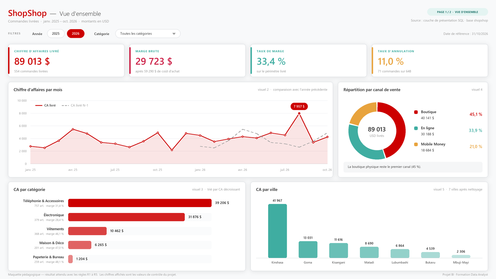
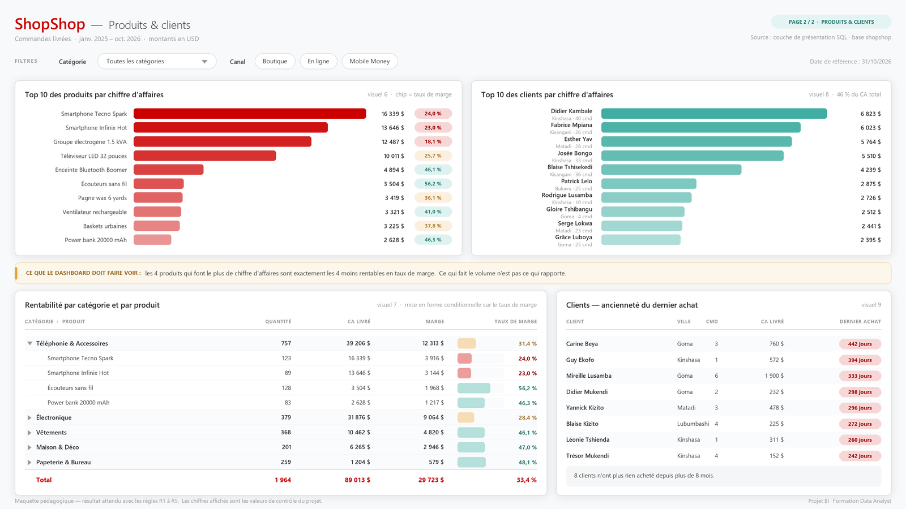

# 📝 Le brief — Dashboard de pilotage commercial ShopShop

**Niveau :** débutant · **Durée :** 8 heures · **Outils :** PostgreSQL + Power BI Desktop
**Livrable :** un dashboard de 2 pages, vos vues SQL, une note de mission d'une page

🧭 Ce document dit **ce qu'on vous demande**.
Le [guide pas à pas](2_GUIDE_PAS_A_PAS.md) dit **comment le faire**.
Le [glossaire](3_GLOSSAIRE.md) explique tous les mots que vous ne connaissez pas encore.

---

## 1. Le contexte

ShopShop est une enseigne de distribution installée à Kinshasa, avec des points de
vente à Lubumbashi, Goma, Bukavu, Matadi, Kisangani et Mbuji-Mayi. On y vend de
l'électronique, de la téléphonie, du prêt-à-porter, de la déco et de la papeterie, par
trois canaux : la boutique, la commande en ligne et le Mobile Money.

Les ventes sont enregistrées dans une base PostgreSQL depuis janvier 2025. Le pilotage,
lui, se fait dans un fichier Excel que la comptable met à jour le vendredi.

La direction en a assez. **Le mois dernier, deux chiffres d'affaires différents ont
circulé dans la même réunion.** Personne n'a su dire lequel était le bon. La réunion
s'est terminée sans décision.

Vous êtes recruté·e comme data analyst. Votre mission tient en une phrase :

> **faire en sorte qu'il n'y ait plus qu'un seul chiffre d'affaires chez ShopShop,
> et que tout le monde puisse le retrouver sans vous appeler.**

### 🎒 L'héritage de Jonas

Vous n'arrivez pas sur un terrain vierge. Jonas Mbala, le stagiaire BI précédent, a eu
le temps de livrer la base, les données et **trois vues d'analyse** avant de partir.

Ses vues sont bien écrites. Elles sont documentées. Elles s'exécutent sans une seule
erreur. Elles ont l'air impeccables.

Elles renvoient pourtant des chiffres faux — et ce sont elles qui ont mis deux chiffres
dans la réunion. Vous les trouverez dans
[`sql/03_vues_du_stagiaire.sql`](../sql/03_vues_du_stagiaire.sql).

> 💡 **La première leçon du projet :**
> du SQL qui s'exécute n'est pas du SQL qui a raison.
> Un dashboard construit sur une vue fausse est un dashboard faux, en plus joli.

---

## 2. Ce que vous rendez

Trois fichiers. Pas plus.

| # | Fichier | Ce que c'est |
|---|---|---|
| 1 | `shopshop_dashboard.pbix` | votre dashboard Power BI, 2 pages |
| 2 | `mes_vues.sql` | les 3 vues SQL que vous avez écrites, documentées |
| 3 | `note_de_mission.md` | **1 page** : vos anomalies, vos décisions, vos réponses |

Un modèle de note de mission vous attend dans
[`ressources/modele_note_de_mission.md`](../ressources/modele_note_de_mission.md).
Remplissez-le, ne partez pas d'une page blanche.

---

## 3. Le dictionnaire de données

Cinq tables. Trois décrivent le contexte (**les dimensions**), deux décrivent ce qui
s'est passé (**les faits**).

### Les dimensions — qui ? quoi ? où ?

| Table | Colonne | Type | À savoir |
|---|---|---|---|
| **`clients`**  81 lignes | `id_client` | clé primaire | |
| | `nom` | texte | |
| | `ville` | texte | ⚠️ **saisie à la main par les vendeurs**, aucun contrôle |
| | `province` | texte | saisie depuis une liste déroulante : propre |
| | `date_inscription` | date | création de la fiche client |
| **`categories`**  5 lignes | `id_categorie` | clé primaire | |
| | `nom_categorie` | texte | |
| **`produits`**  25 lignes | `id_produit` | clé primaire | |
| | `nom_produit` | texte | |
| | `id_categorie` | clé étrangère → `categories` | |
| | `prix_vente` | décimal | ce que le client paie, en **USD** |
| | `cout_achat` | décimal | ce que ShopShop a payé, en **USD** |

### Les faits — combien ?

| Table | Colonne | Type | À savoir |
|---|---|---|---|
| **`commandes`**  648 lignes | `id_commande` | clé primaire | une ligne = une transaction |
| | `id_client` | clé étrangère → `clients` | |
| | `date_commande` | date | de 2025-01-01 à 2026-10-31 |
| | `statut` | texte | `livrée` · `en_cours` · `annulée` |
| | `canal` | texte | `Boutique` · `En ligne` · `Mobile Money` |
| | `montant` | décimal | ⚠️ **total tapé à la caisse**, jamais recalculé |
| **`lignes_commande`**  1 289 lignes | `id_ligne` | clé primaire | une ligne = un produit dans un panier |
| | `id_commande` | clé étrangère → `commandes` | |
| | `id_produit` | clé étrangère → `produits` | |
| | `quantite` | entier | |
| | `remise_appliquee` | décimal | remise **en USD**, pas en % · parfois `NULL` |

> Les deux ⚠️ ne sont pas décoratifs. Ce sont les deux colonnes qui font échouer ce
> projet quand on ne les regarde pas de près.

---

## 4. Les 3 questions métier

Votre dashboard doit permettre à la direction de répondre à ces trois questions
**sans vous appeler**. C'est le seul critère qui compte vraiment.

1. **Combien on vend, et est-ce que ça monte ?**
   Quel chiffre d'affaires, quelle marge, quel taux de marge ? Comment ça évolue mois
   après mois, et est-ce que 2026 fait mieux que 2025 ?

2. **Qu'est-ce qui nous fait gagner de l'argent ?**
   Quelles catégories, quels produits, quels canaux font le chiffre d'affaires — et
   est-ce que ce sont bien les mêmes qui font la marge ?

3. **Qui sont nos clients, et lesquels sommes-nous en train de perdre ?**
   Qui sont les 10 meilleurs, où achètent-ils, et qui n'a plus rien commandé depuis
   longtemps ?

---

## 5. Les 5 règles de gestion

C'est l'absence de ces règles qui a mis deux chiffres dans la réunion. La direction les
a tranchées. **Respectez-les à la lettre** : le corrigé est chiffré sur cette base.

| # | Règle | Le détail qui compte |
|---|---|---|
| **R1** | Le chiffre d'affaires se calcule **depuis `lignes_commande`** | `commandes.montant` ne fait pas foi. Jamais. |
| **R2** | Le CA et la marge ne comptent que les commandes **`livrée`** | `en_cours` et `annulée` sont hors périmètre |
| **R3** | CA d'une ligne = `quantite × prix_vente − remise` | une remise à `NULL` vaut **0**, pas « ligne invalide » |
| **R4** | Marge d'une ligne = CA de la ligne − `quantite × cout_achat` | la remise ne change pas le coût d'achat |
| **R5** | Date de référence = **le 31 octobre 2026** | la dernière date de la base, jamais la date du jour |

### 🧮 Et le taux de marge ?

> **Taux de marge = marge totale ÷ CA total.**
> Jamais une moyenne de pourcentages.

Un exemple qui règle la question pour toujours :

| Produit | CA | Marge | Taux |
|---|---|---|---|
| Smartphone | 10 000 | 2 000 | 20 % |
| Stylo | 10 | 8 | 80 % |
| **Total** | **10 010** | **2 008** | **20,06 %** ← le bon |
| *Moyenne des taux* | | | *50 %* ← absurde |

Un pourcentage ne s'additionne pas et ne se moyenne pas. On additionne les montants,
**puis** on divise. Retenez-le : c'est l'erreur la plus fréquente en BI débutante.

---

## 6. Les 5 étapes

Chaque étape est détaillée dans le [guide pas à pas](2_GUIDE_PAS_A_PAS.md), avec les
chiffres à retrouver. Ici, juste le programme.

| Étape | Ce que vous faites | Durée | Vous en sortez avec |
|---|---|---|---|
| **1** | **Installer et explorer** — monter la base, compter les lignes, regarder ce qu'il y a dedans | 45 min | vos premiers chiffres de contrôle |
| **2** | **Auditer** ⭐ — trouver les 5 anomalies et le défaut de chacune des 3 vues de Jonas | 2 h | le tableau d'anomalies de votre note |
| **3** | **Construire la couche propre** — 3 vues SQL qui appliquent les règles R1 → R5 | 2 h | `mes_vues.sql` |
| **4** | **Modéliser dans Power BI** — importer vos vues, 4 relations, 13 mesures DAX | 1 h 30 | un modèle qui affiche 89 012,69 |
| **5** | **Construire le dashboard** — 9 visuels sur 2 pages | 1 h 45 | `shopshop_dashboard.pbix` |
| **6** | **Restituer** — répondre aux 3 questions, chiffres à l'appui | 30 min | `note_de_mission.md` |

> ⭐ **L'étape 2 est celle qui compte.** C'est là qu'on sépare un data analyst d'un
> opérateur de logiciel. Ne la bâclez pas pour aller « faire du joli » plus vite.

### 🏗️ Une décision a déjà été prise pour vous

Dans un vrai projet, vous auriez à choisir **où mettre la logique métier** : dans
Power BI (chaque analyste refait ses calculs dans son fichier), ou dans la base
(la règle est écrite une fois, tout le monde la lit).

**Ici, on impose la deuxième.** Vous écrivez vos règles en SQL, dans des vues, et
Power BI les consomme déjà propres. C'est ce qui se fait en entreprise, et c'est aussi
beaucoup plus simple pour vous : vos mesures DAX tiendront sur une ligne.

Le guide pas à pas vous explique en détail pourquoi, à l'étape 3. Lisez-le : c'est la
question qu'on vous posera en entretien d'embauche.

---

## 7. Le dashboard : 9 visuels, 2 pages

**Pour les deux pages :** un titre lisible, deux segments (slicers) qui filtrent toute
la page, des nombres formatés (séparateur de milliers, 0 ou 2 décimales — pas 14), et
des libellés en français sans nom technique visible (`nom_produit` → « Produit »).

### 📄 Page 1 — Vue d'ensemble

> Répond à la question métier n° 1.

| # | Visuel | Contenu |
|---|---|---|
| 1 | **4 cartes KPI** | CA livré · Marge brute · Taux de marge · Taux d'annulation |
| 2 | **Courbe** | CA par mois, avec une deuxième série : le CA de l'année précédente |
| 3 | **Barres horizontales** | CA par catégorie, trié du plus grand au plus petit |
| 4 | **Anneau (donut)** | Répartition du CA par canal de vente |
| 5 | **Barres** | CA par ville |

### 📄 Page 2 — Produits et clients

> Répond aux questions métier n° 2 et n° 3.

| # | Visuel | Contenu |
|---|---|---|
| 6 | **Barres horizontales** | Top 10 des produits par CA |
| 7 | **Matrice** | Catégorie › Produit, avec Quantité, CA, Marge, Taux de marge, et une mise en forme conditionnelle sur le taux |
| 8 | **Barres horizontales** | Top 10 des clients par CA |
| 9 | **Tableau** | Liste clients : nom, ville, nb de commandes, CA, jours depuis le dernier achat |

**Ce que vous décidez vous-même :** les couleurs (un thème ShopShop vous est fourni dans
`ressources/`), la mise en page, les info-bulles, et tout visuel supplémentaire qui
vous semble utile. Comme en entreprise : on vous donne les questions, pas la maquette
au pixel près.

> 📐 **Comment lire les maquettes ci-dessus.** Elles servent à deux choses : vous
> montrer **quels chiffres** doivent sortir (ce sont les vraies valeurs de la base)
> et **quel niveau de finition** est attendu — titres, périmètre affiché, nombres
> formatés, libellés en français. Elles ne sont pas un modèle à copier au pixel :
> votre disposition peut différer, vos chiffres non.
> Les fichiers sont dans [`ressources/maquettes/`](../ressources/maquettes/).

---

## 8. La notation — 20 points

| Bloc | Ce qu'on regarde | Points |
|---|---|---|
| **Audit** | Les 5 anomalies trouvées, chiffrées, et une **décision écrite** pour chacune (1 pt par anomalie) | 5 |
| | *inclus ci-dessus :* le défaut des 3 vues de Jonas identifié | |
| **SQL** | Les 3 vues écrites, documentées (en-tête standard), et qui passent les contrôles | 5 |
| **Power BI** | Le modèle en étoile (4 relations) et les 13 mesures qui tombent sur les bonnes valeurs | 5 |
| **Dashboard** | Les 9 visuels, corrects et lisibles | 3 |
| **Restitution** | Les 3 questions métier répondues avec des chiffres + 2 recommandations | 2 |
| | **Total** | **20** |

**Barème indicatif :** < 10 à reprendre · 10–13 acquis partiel · 14–16 bon niveau ·
≥ 17 niveau professionnel.

### ✅ La checklist avant de rendre

Cochez. Si une case ne se coche pas, vous n'avez pas fini.

- [ ] Mon dashboard affiche **89 012,69** en CA livré
- [ ] Il affiche **29 722,69** en marge brute et **33,39 %** en taux de marge
- [ ] Il affiche **10,96 %** en taux d'annulation
- [ ] Ma courbe mensuelle commence en **janvier 2025** (et pas en avril)
- [ ] Mon CA par ville affiche **7 villes**, pas 18
- [ ] Mes 3 vues ont chacune l'en-tête de documentation (Vue / Auteur / Créée le / Objectif / Sources)
- [ ] Ma note de mission donne une **décision** pour chaque anomalie, pas juste un constat
- [ ] Aucun visuel n'affiche un nom de colonne technique (`ca_ligne`, `id_produit`…)

### ⛔ Les fautes qui coûtent cher

| La faute | Ce qu'elle coûte |
|---|---|
| Calculer le CA depuis `commandes.montant` | **tout le bloc Power BI à 0.** C'est la faute que ce projet existe pour vous apprendre à ne plus commettre |
| Un dashboard joli construit sur des chiffres faux | noté plus sévèrement qu'un dashboard sobre et juste |
| Une anomalie repérée mais pas décidée (« il y a des NULL », point) | la moitié des points de l'anomalie |
| Un taux de marge calculé comme une moyenne de pourcentages | le bloc Power BI divisé par deux |

---

## 9. Si vous avez fini et que ça vous amuse

Par ordre de valeur pour votre portfolio :

1. ⭐ **Une jauge d'objectif.** La direction vise 50 000 USD de CA sur 2026. Affichez
   où on en est, en jauge, sur la page 1.
2. ⭐ **Un nuage de points produits.** CA en X, taux de marge en Y, un point par
   produit, taille = quantité vendue. C'est le visuel qui montre d'un coup d'œil les
   produits qui font du volume sans rapporter d'argent.
3. **Deux anomalies de plus**, laissées de côté dans la version simplifiée :
   - un client est enregistré deux fois dans la base. Lequel ? Et qu'en faites-vous ?
     (indice : comparez les noms en ignorant la casse et les espaces)
   - une ligne de vente a une marge **négative**. Laquelle, et pourquoi ?
4. **Une segmentation RFM** : classez chaque client en Champion / Fidèle / À risque /
   Perdu, selon sa récence, sa fréquence et son montant.
5. **Le thème ShopShop** : chargez `ressources/theme_shopshop.json` dans Power BI
   (Affichage → Thèmes → Rechercher des thèmes).
6. **Une page 3 « Qualité des données »** qui affiche en permanence le nombre
   d'anomalies détectées. Dans une vraie entreprise, c'est la page que le responsable
   data regarde en premier le lundi matin.

---

## 10. Trois conseils avant de commencer

1. **Ne commencez pas par Power BI.** Commencez par SQL, et par compter les lignes. Si
   vous ne savez pas combien de commandes contient la base, vous ne saurez jamais
   repérer que votre dashboard en a oublié 94.

2. **Notez vos chiffres de contrôle au fur et à mesure.** CA, marge, nombre de
   commandes. Dès que Power BI vous affiche autre chose, vous saurez immédiatement que
   quelque chose a cassé — et le guide vous dira quoi.

3. **Une anomalie se décide, elle ne se cache pas.** Vous allez trouver des données
   sales. Votre travail n'est pas de les faire disparaître discrètement : c'est de
   choisir quoi en faire, de l'écrire, et de pouvoir le défendre en réunion.

---

👉 **La suite :** [le guide pas à pas](2_GUIDE_PAS_A_PAS.md), étape 1.

*Projet BI ShopShop · Formation Data Analyst*
