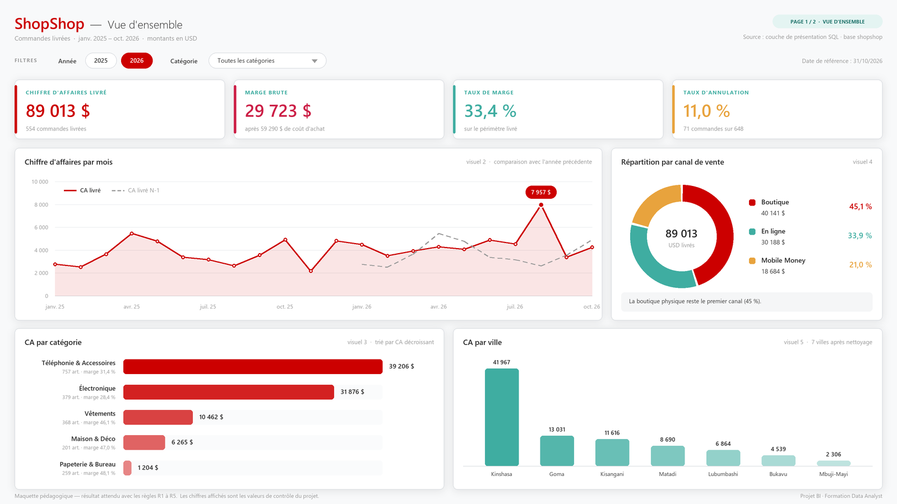
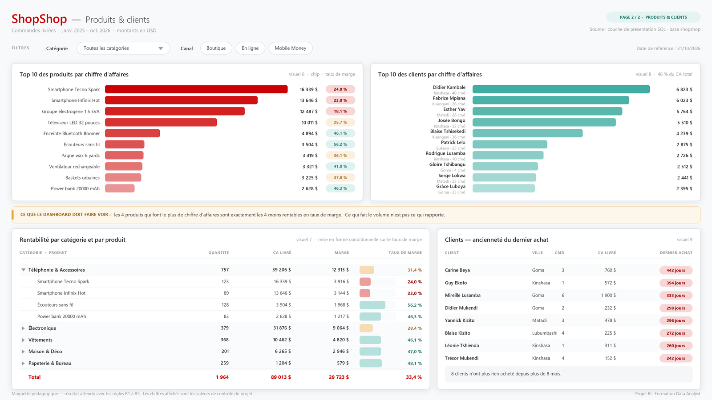

# 🧭 Le guide pas à pas

Le [brief](1_ENONCE.md) dit **ce qu'on vous demande**. Ce guide dit **comment le faire**,
étape par étape, avec les chiffres à retrouver à chaque fois.

**Comment l'utiliser :** faites les étapes dans l'ordre. À la fin de chacune, il y a un
encadré ✅ avec un nombre. Si vous trouvez ce nombre, continuez. Si vous trouvez autre
chose, l'encadré 🩹 juste en dessous vous dit où chercher.

> Un mot que vous ne connaissez pas ? Il est dans le [glossaire](3_GLOSSAIRE.md).

| Étape | | Durée |
|---|---|---|
| [1](#étape-1--installer-et-explorer) | Installer et explorer | 45 min |
| [2](#étape-2--laudit-qualité-) | L'audit qualité ⭐ | 2 h |
| [3](#étape-3--construire-la-couche-propre) | Construire la couche propre | 2 h |
| [4](#étape-4--modéliser-dans-power-bi) | Modéliser dans Power BI | 1 h 30 |
| [5](#étape-5--construire-le-dashboard) | Construire le dashboard | 1 h 45 |
| [6](#étape-6--restituer) | Restituer | 30 min |

---

# Étape 1 — Installer et explorer

> 🎯 **Objectif :** avoir une base qui marche, et savoir ce qu'il y a dedans.

## 1.1 Monter la base

Suivez [l'installation du README](../README.md#-installation-20-minutes). Quatre
fichiers SQL, dans l'ordre : `01`, `02`, `03`, `05`.

## 1.2 Compter avant toute chose

Ouvrez [`sql/04_boite_a_outils.sql`](../sql/04_boite_a_outils.sql) et exécutez les
requêtes **E1**, **E2** et **E3**.

### 💡 Pourquoi on compte toujours en arrivant

Parce que c'est le seul moyen de savoir, plus tard, que quelque chose a cassé.

Imaginez : dans trois heures, votre dashboard affichera « 554 commandes ». Est-ce que
c'est bon ? Vous ne pourrez répondre que si vous savez qu'il y en a **648 au total**,
dont **554 livrées**. Sinon, vous regarderez un nombre sans savoir s'il est juste.

Un data analyst qui ne connaît pas le volume de sa source travaille à l'aveugle.

> ✅ **Contrôle de l'étape 1**
>
> - 81 clients · 5 catégories · 25 produits · **648 commandes** · 1 289 lignes
> - Période : du **1er janvier 2025** au **31 octobre 2026**
> - Statuts : 554 `livrée` · 71 `annulée` · 23 `en_cours`

> 🩹 **Si ça ne marche pas**
>
> - « relation does not exist » → vous avez sauté `01_creer_la_base.sql`.
> - 0 ligne partout → `02_charger_les_donnees.sql` n'est pas passé : relancez-le et
>   lisez le message en bas de pgAdmin.

## 1.3 Notez cette date : 31 octobre 2026

C'est le dernier jour de données de la base. Pour tout ce projet, **c'est
« aujourd'hui »**.

Pourquoi ? Parce que si vous calculez « il y a combien de jours que ce client n'a rien
acheté ? » à partir de la vraie date du jour, votre réponse change chaque matin. Un
formateur qui corrige votre dashboard la semaine prochaine ne retrouvera jamais vos
chiffres, et vous ne pourrez rien prouver.

> **Règle R5 du brief.** Un chiffre qui bouge tout seul n'est pas auditable.

---

# Étape 2 — L'audit qualité ⭐

> 🎯 **Objectif :** trouver les 5 anomalies de la base et le défaut de chacune des
> 3 vues de Jonas — et surtout, **décider quoi en faire**.

C'est l'étape la plus importante du projet. Un dashboard, ça s'apprend en une semaine.
Savoir qu'une donnée est fausse avant de la mettre dans un graphique, ça fait la
différence entre un data analyst et quelqu'un qui sait cliquer dans Power BI.

**Au fur et à mesure, remplissez le tableau de
[`ressources/modele_note_de_mission.md`](../ressources/modele_note_de_mission.md).**
Pour chaque anomalie : combien de lignes touchées, quel impact, **quelle décision**.

> ⚠️ Un constat n'est pas une décision.
> « Il y a 34 remises à NULL » = un constat. Vous n'avez rien tranché.
> « Les 34 remises à NULL sont traitées comme des remises à 0, parce que la caisse ne
> remplit la case que quand une remise est accordée » = une décision. Vous pouvez la
> défendre en réunion.

## Anomalie 1 — Les deux chiffres d'affaires

**Requêtes A1a et A1b** de la boîte à outils.

A1a compare deux totaux : celui tapé à la caisse, et celui recalculé depuis le détail
des paniers. Vous obtenez **94 165,80** d'un côté, **89 012,69** de l'autre.
**5 153,11 USD d'écart.**

A1b vous dit d'où vient l'écart, commande par commande. Vous trouvez **5 commandes
fautives** — et surtout, une seule explique presque tout :

| Commande | Total des lignes | Total de la caisse | Écart |
|---|---|---|---|
| **517** | 549,00 | **5 490,00** | **+4 941,00** |
| 256 | 199,00 | 163,18 | −35,82 |
| 132 | 186,56 | 152,98 | −33,58 |
| 1 | 78,00 | 46,80 | −31,20 |
| 385 | 96,00 | 113,28 | +17,28 |

Regardez la commande 517 : `549` et `5490`. Quelqu'un a tapé un zéro de trop. Une
seule touche, 4 941 USD de chiffre d'affaires imaginaire, et une réunion de direction
qui part en vrille.

### 💡 Pourquoi `lignes_commande` a raison et `commandes.montant` a tort

| | `commandes.montant` | `lignes_commande` |
|---|---|---|
| D'où ça vient | tapé à la main par la caissière | le détail de ce qui a été scanné |
| Recalculé ? | **jamais** | se recalcule à partir des produits et des prix |
| Une faute de frappe | reste pour toujours | n'existe pas : il n'y a pas de total à taper |
| Détail disponible | aucun | par produit, par catégorie, par quantité |

On ne choisit pas `lignes_commande` parce que c'est plus joli. On la choisit parce
qu'elle **se recalcule**, donc elle se vérifie. C'est ça, une source de vérité : pas la
plus pratique, la plus **contrôlable**.

> 📝 **Votre décision à écrire :** le CA se calcule depuis `lignes_commande`. Et les
> 5 commandes fausses ? Vous les signalez à la comptabilité — ce n'est pas au data
> analyst de corriger des écritures comptables tout seul dans son coin.

## Anomalie 2 — Les remises à `NULL`

**Requêtes A2a et A2b.**

Commencez par A2a. Exécutez-la vraiment, le résultat vaut un long discours :

```sql
SELECT 150 - 0 AS avec_zero, 150 - NULL AS avec_null;
```

→ `150` et… **rien**. Une case vide.

### 💡 Qu'est-ce que `NULL`, exactement ?

`NULL`, ce n'est pas zéro. Ce n'est pas une chaîne vide. C'est **« on ne sait pas »**.

Et c'est contagieux : dès qu'un `NULL` entre dans un calcul, le résultat devient `NULL`.
« 150 moins on-ne-sait-pas » = « on ne sait pas ». Logique, en fait.

Le vrai piège est ailleurs : **`SUM()` ignore silencieusement les `NULL`**. Pas
d'erreur. Pas d'avertissement. Pas de ligne rouge. Votre total est juste… trop petit.

Voici ce qui se passe sur 3 lignes :

| Ligne | quantité × prix | remise | `prix − remise` | Dans le `SUM()` |
|---|---|---|---|---|
| A | 150 | 10 | 140 | ✅ 140 |
| B | 200 | `NULL` | `NULL` | ❌ **ignorée** |
| C | 90 | 0 | 90 | ✅ 90 |
| | | | **Total** | **230** au lieu de 430 |

La ligne B n'a pas été comptée comme 0. Elle a disparu.

Sur ShopShop : **32 lignes** concernées (34 si on compte tous les statuts), et
**1 984,50 USD** qui s'évaporent. 87 028,19 au lieu de 89 012,69.

### 💡 Le remède : `COALESCE`

```sql
COALESCE(remise_appliquee, 0)
```

Ça se lit : « prends `remise_appliquee` ; si c'est `NULL`, prends `0` à la place ».

C'est le pansement le plus utile de tout le SQL. Apprenez-le par cœur : vous
l'écrirez tous les jours de votre vie professionnelle.

> 📝 **Votre décision à écrire :** une remise non saisie veut dire « pas de remise »
> (la caisse ne remplit la case que si on accorde quelque chose). On la traite donc
> comme 0. Si on avait décidé l'inverse — « remise inconnue, ligne inexploitable » —
> il aurait fallu exclure les 32 lignes et l'écrire noir sur blanc. Les deux se
> défendent ; ce qui ne se défend pas, c'est de ne pas choisir.

## Anomalie 3 — Sept villes, dix-huit orthographes

**Requêtes A3a et A3b.**

A3a affiche les villes entourées de crochets, pour rendre les espaces visibles :

```
[Kinshasa]      [KINSHASA]      [KINSHASA ]
[Kinshasa  ]    [kinshasa]      [kinshasa ]
```

Pour PostgreSQL comme pour Power BI, ce sont **six villes différentes**. Votre
graphique « CA par ville » afficherait six barres « Kinshasa », chacune avec un
morceau du vrai total. Personne ne verrait l'erreur, tout le monde lirait un chiffre
faux.

### 💡 Les deux fonctions qui règlent ça

| Fonction | Ce qu'elle fait | `'  KINSHASA  '` devient |
|---|---|---|
| `TRIM(x)` | enlève les espaces au début et à la fin | `'KINSHASA'` |
| `INITCAP(x)` | une majuscule par mot, le reste en minuscules | `'Kinshasa'` |

Enchaînées : `INITCAP(TRIM(ville))` → **18 orthographes deviennent 7 villes**.

> 📝 **Votre décision à écrire :** le nettoyage se fait **dans la base**, dans votre
> vue `v_dim_client` (étape 3). Pourquoi pas dans Power BI ? Parce que le jour où la
> comptabilité exporte la liste clients vers Excel, elle retomberait sur les
> 18 orthographes. Nettoyer dans la base, c'est nettoyer pour tout le monde, une fois.
>
> *(Et la vraie solution de fond, à mentionner dans votre note : mettre une liste
> déroulante dans le logiciel de caisse. Mais ça, ce n'est pas votre périmètre — c'est
> une recommandation, pas une action.)*

## Anomalie 4 — Ce que le `JOIN` fait disparaître

**Requête A4a (fournie), puis A4b (à vous).**

### 💡 `JOIN` et `LEFT JOIN`, en une image

Vous avez une liste de 25 produits, et une liste de ventes.

| | Ce que ça garde | Résultat ici |
|---|---|---|
| `JOIN` (= `INNER JOIN`) | **seulement** les produits qui ont au moins une vente | 23 produits |
| `LEFT JOIN` | **tous** les produits, vente ou pas | 25 produits |

Avec un `JOIN`, les 2 produits jamais vendus ne sont pas « à zéro » dans votre
rapport. **Ils sont absents.** Et un produit absent, personne ne pose de question
dessus. C'est la pire sorte d'erreur : celle qu'on ne voit pas.

Or « ce produit n'a jamais été vendu depuis 22 mois » est exactement le genre
d'information qu'un directeur a envie d'avoir.

### 💡 L'anti-jointure : trouver ce qui n'a pas de correspondance

```sql
SELECT p.id_produit, p.nom_produit
FROM produits p
LEFT JOIN lignes_commande lc ON lc.id_produit = p.id_produit
WHERE lc.id_ligne IS NULL;        -- <-- la ligne magique
```

Ça se lit en deux temps :
1. `LEFT JOIN` garde **tous** les produits, même ceux qui ne trouvent rien en face ;
2. quand il ne trouve rien, il remplit la ligne avec des `NULL`. Donc
   `WHERE lc.id_ligne IS NULL` ne garde **que** les produits sans aucune vente.

C'est la technique la plus utile de l'audit de données. Elle répond à toutes les
questions en « qui n'a jamais… ».

**À vous (A4b) :** combien de clients n'ont jamais eu de commande **livrée** ?
Même technique, en partant de `clients`.

> Attention au piège : « jamais de commande livrée » (14 clients) n'est pas la même
> chose que « jamais de commande du tout » (11 clients). Trois clients ont commandé,
> puis tout a été annulé. Ils existent, et ils rapportent 0 USD.

> 📝 **Votre décision à écrire :** on garde tout le monde, avec des zéros. Un client
> inscrit qui n'achète pas est une information commerciale, pas un trou dans les
> données.

## Anomalie 5 — Les commandes vides

**Requête A5 (à vous).** Même technique qu'en A4a, entre `commandes` et
`lignes_commande`.

Vous trouverez **2 commandes** (les n° 119 et 402), toutes les deux `livrée`, avec un
montant de caisse non nul… et **aucun produit en face**.

### 💡 Pourquoi ça compte vraiment

Posez-vous la question du **panier moyen** :

> panier moyen = CA total ÷ nombre de commandes

Oui, mais **quel** nombre de commandes ?

| Choix | Calcul | Résultat |
|---|---|---|
| Les 554 commandes livrées | 89 012,69 ÷ 554 | **160,67 USD** |
| Les 552 qui contiennent vraiment quelque chose | 89 012,69 ÷ 552 | **161,25 USD** |

Les deux se défendent. Ce qui ne se défend pas, c'est que votre dashboard affiche
160,67 pendant que l'export Excel de la compta affiche 161,25. **C'est exactement ça,
le problème de la réunion de direction** — en plus petit.

> 📝 **Votre décision à écrire :** on retient **552** (les commandes qui ont vraiment
> un contenu), donc **161,25 USD**. Une commande sans ligne n'est pas un panier, c'est
> un problème de saisie. Et on le signale à la comptabilité.

## L'audit des 3 vues de Jonas

Exécutez la requête de contrôle à la fin de
[`sql/03_vues_du_stagiaire.sql`](../sql/03_vues_du_stagiaire.sql). Puis, pour chaque
vue, répondez à une seule question : **qu'est-ce qui est faux, et pourquoi ?**

Les pistes sont dans les commentaires du fichier. Voici le cadre pour vous aider à
formuler :

| La vue | La question à se poser | L'indice |
|---|---|---|
| `v_rentabilite_produits` | pourquoi 23 lignes et pas 25 ? pourquoi 87 028,19 et pas 89 012,69 ? | relisez les anomalies 2 et 4 |
| `v_evolution_ventes_mensuelles` | d'où vient son chiffre d'affaires ? est-ce que `annee=2026` + `mois=8` peut se relier à un calendrier ? | relisez l'anomalie 1 et la règle R1 |
| `v_segmentation_clients` | pourquoi 67 lignes et pas 81 ? que vaut `CURRENT_DATE` demain matin ? | relisez l'anomalie 4 et la règle R5 |

> ✅ **Contrôle de l'étape 2**
> Vous avez, écrit dans votre note : 5 anomalies, chacune avec son nombre de lignes
> touchées **et votre décision** · 3 vues diagnostiquées · et ces trois nombres dans
> un coin :
>
> | | |
> |---|---|
> | CA livré | **89 012,69 USD** |
> | Coût des ventes | **59 290,00 USD** |
> | Marge brute | **29 722,69 USD** |

> 🩹 **Si ça ne tombe pas juste**
>
> - **87 028,19** → il vous manque le `COALESCE` (anomalie 2).
> - **94 165,80** → vous avez sommé `commandes.montant` (anomalie 1).
> - **105 940,51** → vous avez sommé `commandes.montant` *et* oublié de filtrer sur
>   `livrée`.

---

# Étape 3 — Construire la couche propre

> 🎯 **Objectif :** écrire en SQL, une fois pour toutes, les règles de gestion de
> ShopShop. Ensuite, Power BI n'aura plus qu'à lire.

## 3.1 Pourquoi on fait ça en SQL et pas dans Power BI

C'est **la** décision d'architecture du projet, et celle qu'on vous demandera en
entretien d'embauche. Prenez cinq minutes pour la comprendre, vous les regagnerez dix
fois.

Vous avez deux endroits possibles où écrire « le CA, c'est quantité × prix − remise,
sur les commandes livrées » :

| | Dans Power BI (chaque analyste chez lui) | **Dans la base (ce qu'on fait ici)** |
|---|---|---|
| Qui en profite | votre fichier `.pbix`, posé sur votre poste | tout le monde : le dashboard, l'export Excel de la compta, le prochain outil |
| Si la règle change | chacun modifie son fichier, ou pas | une vue modifiée, tout le monde suit |
| Un nouvel arrivant | doit deviner vos calculs dans 40 mesures DAX | lit 30 lignes de SQL commenté |
| Vos mesures DAX | `SUMX`, `RELATED`, du calcul ligne à ligne | `SUM(...)`, une ligne |
| Le risque d'erreur | élevé : chacun réinvente la règle | faible : la règle est écrite une fois |

La maxime du métier, qu'on doit à Matthew Roche (équipe Power BI chez Microsoft) :

> **« Transformez les données le plus en amont possible,
> et le plus en aval que nécessaire. »**

Traduction en français de tous les jours :

- **En amont (en SQL)** : le nettoyage, les types, et les **montants** calculés
  ligne par ligne.
- **En aval (en DAX)** : les additions, et **surtout tous les pourcentages**.

### ⛔ La seule règle qui ne se négocie jamais

**On ne calcule jamais un pourcentage en SQL.**

Un montant s'additionne : 100 + 200 = 300. ✅
Un pourcentage ne s'additionne pas, et ne se moyenne pas :

| Produit | CA | Marge | Taux |
|---|---|---|---|
| Smartphone | 10 000 | 2 000 | 20 % |
| Stylo | 10 | 8 | 80 % |
| **Vrai total** | **10 010** | **2 008** | **20,06 %** |
| *Moyenne des taux* | | | *50 %* ❌ |

Donc : `ca_ligne`, `cout_ligne`, `marge_ligne` → en SQL, dans vos vues.
`taux de marge` → en DAX, dans Power BI, toujours.

### 💡 Qu'est-ce qu'une « couche de présentation » ?

C'est un petit jeu de vues dont le seul but est d'être lu par un outil de BI. Elle a
trois propriétés, et c'est tout :

1. **Au grain le plus fin.** Une ligne de vente reste une ligne de vente. On
   n'agrège pas : ce serait tuer le détail dont Power BI a besoin pour filtrer.
2. **Déjà propre.** La ville est nettoyée, les `NULL` sont traités, les colonnes qui
   mentent ne sortent pas.
3. **En forme d'étoile.** Des tables de faits au milieu, des dimensions autour.

> ⚠️ **Le piège classique :** brancher Power BI sur les vues de Jonas (ou sur des
> vues agrégées en général). Ces vues font déjà un `GROUP BY` par produit, par mois,
> par client. En les utilisant comme source, vous perdez le détail : impossible de
> croiser « produit × ville », impossible de descendre dans une commande.
> **Ce qui disqualifie une vue comme source, c'est son grain, pas sa qualité.**

## 3.2 Les vues à écrire

Vous en écrivez **trois**. Les deux autres vous sont données.

| Vue | Grain (1 ligne = ) | Lignes | Qui l'écrit |
|---|---|---|---|
| `v_dim_calendrier` | un jour | 730 | 🎁 fournie (`sql/05_calendrier.sql`) |
| `v_dim_produit` | un produit | 25 | 📖 exemple donné ci-dessous |
| `v_dim_client` | un client | 81 | ✍️ **vous** |
| `v_fait_commandes` | une commande | 648 | ✍️ **vous** |
| `v_fait_ventes` | une ligne de panier | 1 289 | ✍️ **vous** |

Créez un fichier `mes_vues.sql` et écrivez-y les trois.

### 💡 Dimension ou fait ? Le test en une question

> *Est-ce que cette table grossit quand l'entreprise travaille ?*

- **Oui** → c'est un **fait**. (Une vente de plus, une ligne de plus.) On y additionne
  des nombres.
- **Non** → c'est une **dimension**. (Le catalogue produits ne grossit pas parce qu'on
  a vendu.) On y lit des libellés pour filtrer et regrouper.

Et le mot **grain** veut simplement dire : *une ligne de cette table, c'est quoi ?*
Dans `v_fait_ventes`, une ligne = un produit dans un panier. C'est tout. Mais si vous
ne savez pas répondre à cette question sur une table, vous ne pouvez rien calculer de
juste avec.

### 📖 L'exemple : `v_dim_produit`

Recopiez-la telle quelle. Lisez bien l'en-tête : **vos trois vues devront avoir le
même**, c'est noté.

```sql
-- =====================================================
-- Vue      : v_dim_produit
-- Auteur   : [Votre Nom]
-- Créée le : [Date du jour]
-- Objectif : dimension produit — 1 ligne par produit, avec sa catégorie.
-- Sources  : produits, categories
-- =====================================================
CREATE OR REPLACE VIEW v_dim_produit AS
SELECT
    p.id_produit,
    p.nom_produit,
    c.nom_categorie,                        -- la catégorie est rapatriée ici
    p.prix_vente,
    p.cout_achat,
    (p.prix_vente - p.cout_achat) AS marge_unitaire
FROM produits p
JOIN categories c ON c.id_categorie = p.id_categorie;
```

**Pourquoi la catégorie est-elle rapatriée dans la dimension produit ?**
Parce que `categories` est une toute petite table (5 lignes) qui ne sert qu'à donner
un libellé. En la fusionnant avec `produits`, on passe de trois tables en chaîne
(`categories → produits → ventes`) à deux (`produits → ventes`). Résultat : une
relation de moins à créer dans Power BI, un chemin de filtre de moins à déboguer. Ça
s'appelle **aplatir un flocon en étoile**, et c'est la forme que Power BI préfère.

### ✍️ À vous n° 1 : `v_dim_client`

**Ce qu'elle doit contenir :** `id_client`, `nom`, `ville`, `province`,
`date_inscription`.
**Ce qu'elle doit faire :** nettoyer la ville (anomalie 3) avec `INITCAP(TRIM(...))`.

> ✅ 81 lignes, et `SELECT COUNT(DISTINCT ville) FROM v_dim_client;` → **7**

### ✍️ À vous n° 2 : `v_fait_commandes`

**Ce qu'elle doit contenir :** `id_commande`, `id_client`, `date_commande`, `statut`,
`canal`.
**Ce qu'elle ne doit PAS contenir :** `montant`.

**Pourquoi exclure `montant` ?** Parce que cette colonne ment (anomalie 1). On pourrait
se contenter d'écrire dans la doc « attention, ne l'utilisez pas »… et quelqu'un
l'utilisera dans six mois. En ne l'exposant pas du tout, le piège disparaît.

> **Ce qu'on n'expose pas ne peut pas être mal utilisé.** C'est une des meilleures
> façons de protéger un modèle : enlever la possibilité de se tromper, plutôt que
> prévenir qu'il ne faut pas.

> ✅ 648 lignes, et aucune colonne `montant`.

### ✍️ À vous n° 3 : `v_fait_ventes` — la vue centrale du projet

**Ce qu'elle doit contenir :** `id_ligne`, `id_commande`, `id_produit`, `quantite`,
`remise`, puis **trois colonnes calculées** :

| Colonne | Formule | Règle |
|---|---|---|
| `ca_ligne` | `quantite × prix_vente − remise` | R3 |
| `cout_ligne` | `quantite × cout_achat` | R4 (la remise ne touche pas le coût) |
| `marge_ligne` | `ca_ligne − cout_ligne` | R4 |

Avec, évidemment, `COALESCE(remise_appliquee, 0)` partout où la remise apparaît.

**Pourquoi a-t-on le droit de calculer ces trois colonnes en SQL ?** Parce qu'elles
sont **additives** : si vous additionnez les `ca_ligne` de tous les produits d'une
catégorie, vous obtenez le CA de la catégorie. Ça marche à n'importe quel niveau — par
mois, par ville, par canal. Un pourcentage, lui, ne survivrait pas à l'addition. D'où
la règle.

> ### 🚨 Le piège de cette vue : **ne filtrez PAS sur `statut = 'livrée'`**
>
> La tentation est forte : le CA ne concerne que les commandes livrées, autant filtrer
> tout de suite, non ?
>
> **Non.** Le périmètre « livrée » est une question de **mesure**, pas de
> **structure**. Si vous le figez dans la vue, vous vous interdisez pour toujours
> d'analyser les annulations — et votre taux d'annulation tombera à 0 %, puisqu'il n'y
> aura plus une seule commande annulée dans votre modèle.
>
> Jonas s'est trompé en laissant entrer des données fausses. L'erreur inverse — filtrer
> trop tôt — est **plus grave** : une donnée fausse se corrige, une donnée perdue ne
> revient pas.
>
> Le filtre `livrée` se mettra à l'étape 4, dans vos mesures DAX. Une seule fois.

> ✅ **Contrôle de l'étape 3** — exécutez ces deux requêtes.
>
> ```sql
> SELECT 'v_dim_client' AS vue, COUNT(*) FROM v_dim_client
> UNION ALL SELECT 'v_dim_produit',    COUNT(*) FROM v_dim_produit
> UNION ALL SELECT 'v_dim_calendrier', COUNT(*) FROM v_dim_calendrier
> UNION ALL SELECT 'v_fait_commandes', COUNT(*) FROM v_fait_commandes
> UNION ALL SELECT 'v_fait_ventes',    COUNT(*) FROM v_fait_ventes;
> ```
> → **81 · 25 · 730 · 648 · 1289**
>
> ```sql
> SELECT ROUND(SUM(fv.ca_ligne), 2)    AS ca_livre,
>        ROUND(SUM(fv.cout_ligne), 2)  AS cout,
>        ROUND(SUM(fv.marge_ligne), 2) AS marge
> FROM v_fait_ventes fv
> JOIN v_fait_commandes fc ON fc.id_commande = fv.id_commande
> WHERE fc.statut = 'livrée';
> ```
> → **89 012,69 · 59 290,00 · 29 722,69**

> 🩹 **Si ça ne tombe pas juste**
>
> - `v_fait_ventes` a moins de 1 289 lignes → vous avez filtré sur le statut (voir le
>   piège ci-dessus), ou utilisé un `JOIN` qui exclut quelque chose.
> - CA = 87 028,19 → `COALESCE` oublié.
> - CA ≈ 94 165,80 → vous avez utilisé `commandes.montant` quelque part.
> - `v_dim_client` donne 18 villes → `INITCAP(TRIM(...))` manquant ou mal placé.

---

# Étape 4 — Modéliser dans Power BI

> 🎯 **Objectif :** importer vos 5 vues, les relier, et écrire 13 mesures qui tombent
> juste.

## 4.1 Se connecter

1. Ouvrez **Power BI Desktop** → `Accueil` → `Obtenir les données` → `Plus…`
2. Catégorie `Base de données` → **`Base de données PostgreSQL`** → `Connecter`
3. Serveur : **`localhost`** · Base de données : **`shopshop`**
4. Mode : **Importer** (pas DirectQuery)
5. Identifiants : `postgres` + votre mot de passe → `Connecter`
6. Dans le **Navigateur**, cochez **uniquement vos 5 vues** :
   `v_dim_calendrier` · `v_dim_client` · `v_dim_produit` · `v_fait_commandes` ·
   `v_fait_ventes`
7. Cliquez sur **`Transformer les données`** (pas `Charger` : on va jeter un œil)

> ❗ **Ne cochez pas les tables brutes** (`clients`, `commandes`…). Si vous les
> importez aussi, vous aurez deux sources pour la même chose, et vous finirez par vous
> tromper. Et ne cochez pas non plus les vues de Jonas : elles vont à la poubelle.

> 🩹 Pas de connecteur PostgreSQL dans la liste → installez **Npgsql** et redémarrez
> Power BI. Erreur de mot de passe → `Fichier` → `Options et paramètres` →
> `Paramètres de la source de données` → `Effacer les autorisations`, puis recommencez.

## 4.2 Power Query : trois minutes, pas une heure

L'**éditeur Power Query** s'ouvre. C'est l'endroit où on nettoie les données avant
qu'elles entrent dans le modèle.

Vous n'allez presque rien y faire. Vérifiez seulement, pour chaque table, que les
types sont bons (l'icône à gauche de chaque nom de colonne) :

| Colonne | Type attendu |
|---|---|
| `date_jour`, `date_commande`, `date_inscription` | 📅 Date |
| `ca_ligne`, `cout_ligne`, `marge_ligne`, `prix_vente`, `cout_achat`, `remise` | 1.2 Nombre décimal |
| `quantite`, `annee`, `mois_numero`, `mois_tri` | 123 Nombre entier |
| le reste | ABC Texte |

Puis `Accueil` → **`Fermer et appliquer`**.

> 💡 **Vous venez de voir le bénéfice de l'étape 3.**
> Dans la version d'origine de ce projet, cette étape durait une heure : il fallait
> nettoyer la ville, remplacer les `NULL`, supprimer la colonne `montant`, retyper
> des colonnes. Vous, vous avez fait tout ça en SQL — une fois, pour tout le monde.
> Power Query n'a plus rien à nettoyer.
>
> C'est exactement ce qu'on vous demandera de démontrer en entretien.

## 4.3 Le modèle en étoile

Cliquez sur l'icône **Modèle** (la troisième dans la barre de gauche).

### 💡 Qu'est-ce qu'un modèle en étoile, concrètement ?

Au centre, les **faits** : ce qui s'est passé, et qu'on additionne.
Autour, les **dimensions** : les filtres et les libellés.

Et les flèches vont **des dimensions vers les faits**, toujours. Quand vous cliquez
sur « Kinshasa » dans un segment, le filtre descend de `v_dim_client` vers
`v_fait_commandes`, puis vers `v_fait_ventes`. Vos cartes KPI se recalculent. C'est
tout le mécanisme de Power BI, et il tient en une phrase.

```
      v_dim_calendrier                v_dim_client
             │                             │
             │ 1                         1 │
             └──────────────┬──────────────┘
                            ▼  *
                    v_fait_commandes            648 lignes
                            │ 1
                            ▼  *
                     v_fait_ventes              1 289 lignes
                            ▲  *
                            │ 1
                     v_dim_produit
```

### Les 4 relations à créer

Faites glisser le champ de gauche sur le champ de droite :

| # | De | Vers | Cardinalité | Sens du filtre |
|---|---|---|---|---|
| 1 | `v_dim_calendrier[date_jour]` | `v_fait_commandes[date_commande]` | un vers plusieurs (1:*) | simple → |
| 2 | `v_dim_client[id_client]` | `v_fait_commandes[id_client]` | un vers plusieurs (1:*) | simple → |
| 3 | `v_fait_commandes[id_commande]` | `v_fait_ventes[id_commande]` | un vers plusieurs (1:*) | simple → |
| 4 | `v_dim_produit[id_produit]` | `v_fait_ventes[id_produit]` | un vers plusieurs (1:*) | simple → |

**Toutes en « un vers plusieurs », toutes en filtre simple.** Si Power BI vous propose
« plusieurs à plusieurs » ou « bidirectionnel », quelque chose ne va pas : vérifiez
que votre dimension n'a pas de doublon sur sa clé.

> ❓ **« Pourquoi deux tables de faits ? »**
> Parce qu'il y a deux grains. On compte des **commandes** (648) et on additionne des
> **ventes** (1 289) : ce ne sont pas les mêmes lignes.
> La preuve par l'absurde : si vous supprimiez `v_fait_commandes`, les 2 commandes
> vides (anomalie 5) disparaîtraient du modèle. Vous compteriez 646 commandes au lieu
> de 648, et votre taux d'annulation serait faux.
> `v_fait_commandes` joue ici deux rôles : table de faits (on y compte) **et** pont
> entre les dimensions et les ventes.

### Les 3 réglages qu'on oublie toujours

1. **Marquer le calendrier comme table de dates.**
   Clic droit sur `v_dim_calendrier` → `Marquer comme table de dates` → colonne
   `date_jour`.
   *Sans ça, `SAMEPERIODLASTYEAR` ne marchera pas, et vous chercherez pendant une heure.*

2. **Trier les mois dans le bon ordre.**
   Sélectionnez la colonne `mois_annee` → onglet `Outils de colonnes` →
   `Trier par colonne` → **`mois_tri`**.
   *Sans ça, votre axe affiche « août, avr., déc., févr., janv. » — l'ordre
   alphabétique. Votre année commence en août.*

3. **Masquer les colonnes techniques.**
   Dans la vue Modèle, clic droit sur chaque `id_…` → `Masquer dans la vue rapport`.
   *Personne dans la direction n'a besoin de voir `id_produit`. Un modèle propre,
   c'est un modèle où on ne peut glisser que des champs utiles.*

## 4.4 Les 13 mesures DAX

### 💡 Mesure ou colonne ? La différence en une phrase

- Une **colonne calculée** est calculée **une fois**, ligne par ligne, et stockée.
- Une **mesure** est recalculée **à chaque fois que vous cliquez**, en fonction de ce
  qui est filtré à l'écran.

Votre « CA livré » doit valoir 89 012,69 en global, et autre chose quand on filtre sur
Kinshasa. Donc : **une mesure**. En BI, la règle de pouce est simple — *dans le doute,
une mesure*.

**Comment en créer une :** onglet `Accueil` → `Nouvelle mesure`, puis tapez la formule
dans la barre. Rangez-les toutes dans `v_fait_ventes` pour les retrouver facilement.

### Les 4 mesures d'argent

```dax
CA livré =
CALCULATE (
    SUM ( v_fait_ventes[ca_ligne] ),
    v_fait_commandes[statut] = "livrée"
)
```

**Comment lire `CALCULATE` ?** « Fais cette addition, **mais** en appliquant d'abord ce
filtre. » C'est la fonction la plus importante de tout DAX : elle sert à changer le
contexte d'un calcul.

Et remarquez : la somme porte sur `v_fait_ventes`, le filtre sur `v_fait_commandes`.
Ça marche grâce à la relation n° 3 — le filtre descend de la commande vers ses lignes.

```dax
Coût des ventes =
CALCULATE ( SUM ( v_fait_ventes[cout_ligne] ), v_fait_commandes[statut] = "livrée" )
```

```dax
Marge brute =
CALCULATE ( SUM ( v_fait_ventes[marge_ligne] ), v_fait_commandes[statut] = "livrée" )
```

```dax
Taux de marge = DIVIDE ( [Marge brute], [CA livré] )
```

> **Pourquoi `DIVIDE` et pas `/` ?** Parce que `DIVIDE` renvoie un blanc au lieu de
> planter si le dénominateur vaut 0. Sur un dashboard filtré sur un mois sans vente,
> ça vous évite une case `Infinity` en rouge devant la direction.
>
> Et notez bien : **le taux est calculé ici, en DAX, à partir des deux totaux.**
> Jamais en SQL, jamais comme une moyenne de pourcentages. (Voir étape 3.)

### Les 4 mesures de volume

```dax
Nb commandes = COUNTROWS ( v_fait_commandes )
```

```dax
Nb commandes livrées =
CALCULATE ( COUNTROWS ( v_fait_commandes ), v_fait_commandes[statut] = "livrée" )
```

```dax
Taux d'annulation =
DIVIDE (
    CALCULATE ( COUNTROWS ( v_fait_commandes ), v_fait_commandes[statut] = "annulée" ),
    [Nb commandes]
)
```

> Attention au dénominateur : **toutes** les commandes, tous statuts confondus. Un taux
> d'annulation calculé sur les seules commandes annulées vaudrait toujours 100 %.

```dax
Quantité vendue =
CALCULATE ( SUM ( v_fait_ventes[quantite] ), v_fait_commandes[statut] = "livrée" )
```

### Le panier moyen

```dax
Panier moyen =
DIVIDE (
    [CA livré],
    CALCULATE (
        DISTINCTCOUNT ( v_fait_ventes[id_commande] ),
        v_fait_commandes[statut] = "livrée"
    )
)
```

`DISTINCTCOUNT` sur `v_fait_ventes` ne voit que les commandes **qui ont au moins une
ligne**. Il compte donc 552 et non 554 : votre décision de l'anomalie 5 est appliquée
automatiquement, sans que vous ayez à exclure quoi que ce soit à la main. Les bonnes
décisions de modélisation font ça — elles rendent l'erreur impossible.

### La comparaison avec l'année précédente

```dax
CA livré N-1 =
CALCULATE ( [CA livré], SAMEPERIODLASTYEAR ( v_dim_calendrier[date_jour] ) )
```

`SAMEPERIODLASTYEAR` décale la période affichée d'exactement un an en arrière. C'est
pour **cette seule fonction** qu'on a eu besoin d'un calendrier complet, années civiles
entières, marqué comme table de dates.

> ⚠️ **Un avertissement que peu de dashboards donnent.**
> Ne comparez pas « toute l'année 2026 » à « toute l'année 2025 » dans ce projet :
> 2025 est complète (43 764,06 USD) alors que 2026 s'arrête au 31 octobre
> (45 248,63 USD). Vous conclueriez « +3 % », ce qui est faux.
> La bonne comparaison est à période égale, **janvier–octobre** :
> **36 796,97 → 45 248,63, soit +23 %.**
> C'est le genre de piège qui fait prendre une mauvaise décision en comité de
> direction. Signalez-le dans votre note : ça vaut des points.

### Les 3 mesures pour la page clients

```dax
Date de référence = MAXX ( ALL ( v_fait_commandes ), v_fait_commandes[date_commande] )
```

`ALL(...)` veut dire « ignore tous les filtres de l'écran ». Cette mesure vaut donc
toujours le **31/10/2026**, quoi que l'utilisateur clique. C'est la règle R5 traduite
en DAX.

```dax
Dernier achat =
CALCULATE ( MAX ( v_fait_commandes[date_commande] ), v_fait_commandes[statut] = "livrée" )
```

```dax
Jours depuis dernier achat = DATEDIFF ( [Dernier achat], [Date de référence], DAY )
```

### Le formatage (ne le sautez pas)

Pour chaque mesure : sélectionnez-la, puis onglet `Outils de mesure` :

| Mesure | Format | Décimales |
|---|---|---|
| CA livré, Coût des ventes, Marge brute, CA livré N-1, Panier moyen | Devise `$ English (United States)` | 0 (sauf panier moyen : 2) |
| Taux de marge, Taux d'annulation | Pourcentage | 1 ou 2 |
| Nb commandes, Nb commandes livrées, Quantité vendue, Jours depuis dernier achat | Nombre entier | 0 |

Un KPI qui affiche `89012,6899999998` n'est pas un KPI, c'est un brouillon.

> ✅ **Contrôle de l'étape 4**
> Posez une carte vide sur la page et faites défiler vos mesures dedans :
>
> | Mesure | Valeur attendue |
> |---|---|
> | CA livré | **89 012,69** |
> | Coût des ventes | **59 290,00** |
> | Marge brute | **29 722,69** |
> | Taux de marge | **33,39 %** |
> | Nb commandes | **648** |
> | Nb commandes livrées | **554** |
> | Taux d'annulation | **10,96 %** |
> | Panier moyen | **161,25** |
> | Quantité vendue | **1 964** |
> | Date de référence | **31/10/2026** |
>
> Les dix doivent tomber juste **avant** de commencer le dashboard. Un visuel construit
> sur une mesure fausse, c'est du temps perdu deux fois.

> 🩹 **Tableau de diagnostic** — vous voyez ce nombre ? voici l'erreur :
>
> | Vous voyez | Ce qui s'est passé |
> |---|---|
> | **94 165,80** | vous additionnez `commandes.montant` (vous avez importé les tables brutes) |
> | **87 028,19** | `COALESCE` oublié dans `v_fait_ventes` |
> | **105 940,51** | `commandes.montant` **et** pas de filtre `livrée` |
> | **100 787,40** | pas de filtre sur `livrée` dans vos mesures (vous comptez aussi les annulées) |
> | **0 %** de taux d'annulation | vous avez filtré `livrée` dans `v_fait_ventes` ou `v_fait_commandes` |
> | **646** commandes | vous comptez depuis `v_fait_ventes` au lieu de `v_fait_commandes` |
> | **50 %** de taux de marge | vous faites une moyenne de pourcentages |
> | Un axe qui commence en **août** | `mois_annee` n'est pas trié par `mois_tri` |
> | `CA livré N-1` toujours vide | calendrier non marqué comme table de dates, ou relation 1 absente |

---

# Étape 5 — Construire le dashboard

> 🎯 **Objectif :** 9 visuels sur 2 pages, qui répondent aux 3 questions métier sans
> qu'on ait besoin de vous appeler.

Les deux maquettes de référence sont reproduites ci-dessous, chacune juste avant sa
page. Les fichiers sont dans [`ressources/maquettes/`](../ressources/maquettes/) si
vous voulez les ouvrir en grand à côté de Power BI.

## 5.1 Trois règles avant de poser le premier visuel

1. **Un visuel = une question.** Si vous ne savez pas dire à quelle question votre
   graphique répond, enlevez-le. Un dashboard de 30 visuels que personne ne lit est
   moins utile qu'un dashboard de 9 qu'on comprend.
2. **Les KPI en haut à gauche.** On lit un écran comme une page : en Z, de haut en bas
   et de gauche à droite. Ce qui compte le plus se met là où l'œil arrive en premier.
3. **Aucun nom technique visible.** `ca_ligne` ne veut rien dire pour la direction.
   Pour renommer sans rien casser : glissez le champ dans le visuel, puis
   **double-cliquez sur son nom dans le volet** et tapez « Chiffre d'affaires ». Ça ne
   change que l'affichage.

## 5.2 Page 1 — Vue d'ensemble



> 📐 **Lisez la maquette avant de poser un visuel.** Les cinq visuels y sont numérotés
> (« visuel 2 », « visuel 3 »…) et tous les chiffres affichés sont les vraies valeurs
> de la base. Visez les **mêmes nombres**, pas le même pixel : la disposition, les
> couleurs et les visuels en plus restent vos décisions.

Renommez l'onglet en bas : `Vue d'ensemble`.

| # | Visuel | Champs | Ce qu'on en fait |
|---|---|---|---|
| 1 | **4 cartes** | `CA livré` · `Marge brute` · `Taux de marge` · `Taux d'annulation` | alignées en haut, même taille |
| 2 | **Graphique en courbes** | Axe X : `v_dim_calendrier[mois_annee]` · Valeurs : `CA livré` et `CA livré N-1` | l'évolution, avec la comparaison |
| 3 | **Barres horizontales** | Axe Y : `v_dim_produit[nom_categorie]` · Valeurs : `CA livré` | trié décroissant |
| 4 | **Anneau** | Légende : `v_fait_commandes[canal]` · Valeurs : `CA livré` | 3 parts, pas plus |
| 5 | **Barres** | Axe : `v_dim_client[ville]` · Valeurs : `CA livré` | **7 barres**, c'est votre preuve que le nettoyage a marché |

**Les 2 segments (slicers) :** `v_dim_calendrier[annee]` et
`v_dim_produit[nom_categorie]`.

> ✅ **Les chiffres à retrouver sur cette page**
>
> | Par catégorie | CA |
> |---|---|
> | Téléphonie & Accessoires | 39 205,55 |
> | Électronique | 31 876,27 |
> | Vêtements | 10 462,21 |
> | Maison & Déco | 6 264,76 |
> | Papeterie & Bureau | 1 203,90 |
>
> | Par canal | CA | Part |
> |---|---|---|
> | Boutique | 40 140,53 | 45 % |
> | En ligne | 30 188,04 | 34 % |
> | Mobile Money | 18 684,12 | 21 % |
>
> | Par ville | CA |
> |---|---|
> | Kinshasa | 41 966,75 |
> | Goma | 13 030,73 |
> | Kisangani | 11 615,71 |
> | Matadi | 8 689,70 |
> | Lubumbashi | 6 864,11 |
> | Bukavu | 4 539,44 |
> | Mbuji-Mayi | 2 306,25 |
>
> Et sur la courbe : un pic très net en **août 2026 (7 956,65)**, un creux en
> **novembre 2025 (2 160,34)**.

## 5.3 Page 2 — Produits et clients



Renommez l'onglet : `Produits & clients`.

| # | Visuel | Champs | Réglage |
|---|---|---|---|
| 6 | **Barres horizontales** | `v_dim_produit[nom_produit]` × `CA livré` | Filtres → `nom_produit` → **N premiers** → 10, par `CA livré` |
| 7 | **Matrice** | Lignes : `nom_categorie` puis `nom_produit` · Valeurs : `Quantité vendue`, `CA livré`, `Marge brute`, `Taux de marge` | mise en forme conditionnelle sur le taux (barres de données ou échelle de couleurs) |
| 8 | **Barres horizontales** | `v_dim_client[nom]` × `CA livré` | même filtre « 10 premiers » |
| 9 | **Tableau** | `nom`, `ville`, `Nb commandes livrées`, `CA livré`, `Jours depuis dernier achat` | trier par `Jours depuis dernier achat` décroissant : les clients en train de partir arrivent en haut |

> ✅ **Les chiffres à retrouver**
>
> | Top 5 produits | CA | Taux de marge |
> |---|---|---|
> | Smartphone Tecno Spark | 16 339,05 | 24,0 % |
> | Smartphone Infinix Hot | 13 646,20 | 23,0 % |
> | Groupe électrogène 1.5 kVA | 12 487,00 | **18,1 %** |
> | Téléviseur LED 32 pouces | 10 010,70 | 25,7 % |
> | Enceinte Bluetooth Boomer | 4 893,75 | 46,1 % |
>
> | Top 3 clients | CA |
> |---|---|
> | Didier Kambale | 6 823,48 |
> | Fabrice Mpiana | 6 022,85 |
> | Esther Yav | 5 764,15 |
>
> Quantité vendue totale : **1 964 articles**.

> 💡 **Regardez votre matrice deux minutes avant de passer à la suite.**
> La Papeterie fait le plus petit CA (1 204 USD) mais le **meilleur** taux de marge
> (48 %). La Téléphonie fait le plus gros CA (39 206 USD) avec le **moins bon** taux
> (31 %). Autrement dit : ce qui fait le chiffre d'affaires n'est pas ce qui rapporte
> le plus par dollar vendu.
>
> Ça, c'est une information que la direction n'a pas aujourd'hui. C'est pour ça qu'on
> vous a recruté.

## 5.4 La finition (20 minutes bien investies)

- **Un titre par page**, en haut à gauche : « ShopShop — Vue d'ensemble »,
  « ShopShop — Produits & clients ».
- **Un sous-titre qui dit le périmètre** : « Commandes livrées · janv. 2025 –
  oct. 2026 · montants en USD ». Trois secondes à écrire, et plus personne ne vous
  demandera « c'est en quelle devise ? ».
- **Le thème** : `Affichage` → `Thèmes` → `Rechercher des thèmes` →
  `ressources/theme_shopshop.json`.
- **Testez vos segments** : cliquez sur 2026, puis sur une catégorie. Tous les visuels
  de la page doivent réagir. Si l'un reste figé, vérifiez vos relations.

---

# Étape 6 — Restituer

> 🎯 **Objectif :** une page qui se lit en trois minutes, par quelqu'un qui ne sait pas
> ce qu'est une jointure.

Complétez
[`ressources/modele_note_de_mission.md`](../ressources/modele_note_de_mission.md).

## Les 3 questions, et comment y répondre

**Ne répondez jamais sans un chiffre.** « Les ventes progressent » ne vaut rien.
« Le CA janvier–octobre passe de 36 797 à 45 249 USD, soit +23 % » vaut une réunion.

| Question | Ce qu'on attend dans votre réponse |
|---|---|
| **1. Combien on vend, est-ce que ça monte ?** | le CA, la marge, le taux de marge, l'évolution janv.–oct. 2025 → 2026, et les deux mois remarquables |
| **2. Qu'est-ce qui nous fait gagner de l'argent ?** | le classement par catégorie et par canal, **et** l'écart entre « fait du CA » et « fait de la marge » |
| **3. Qui sont nos clients, qui perd-on ?** | le poids des 10 premiers, la concentration géographique, et les clients sans achat récent |

## Les 2 recommandations

Une recommandation, ce n'est pas un constat. C'est une **action**, adressée à
**quelqu'un**, avec un **ordre de grandeur**.

| ❌ Pas une recommandation | ✅ Une recommandation |
|---|---|
| « Le taux d'annulation est élevé » | « Appeler les clients dont la commande est en cours depuis plus de 7 jours : 71 commandes annulées sur 22 mois, soit environ 11 % du volume » |
| « La papeterie marge bien » | « Mettre la papeterie en tête de gondole : 48 % de taux de marge contre 31 % pour la téléphonie, pour seulement 1 204 USD de CA aujourd'hui » |

> ✅ **Contrôle de l'étape 6**
> Votre note tient sur **une page**. Chaque anomalie a une **décision**. Chaque
> réponse a un **chiffre**. Chaque recommandation a un **destinataire**.

---

## 🎓 Et maintenant

Reprenez [la checklist du brief](1_ENONCE.md#-la-checklist-avant-de-rendre). Si les
huit cases se cochent, vous avez fini.

Si ça vous a plu, la section bonus du brief vous attend : jauge d'objectif, nuage de
points, deux anomalies de plus, segmentation RFM.

*Projet BI ShopShop · Formation Data Analyst*
