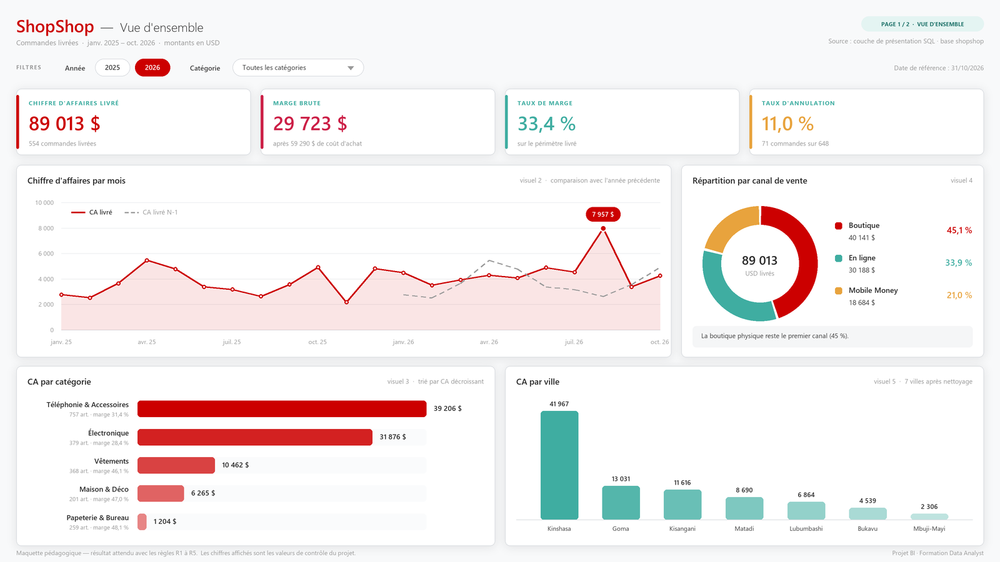
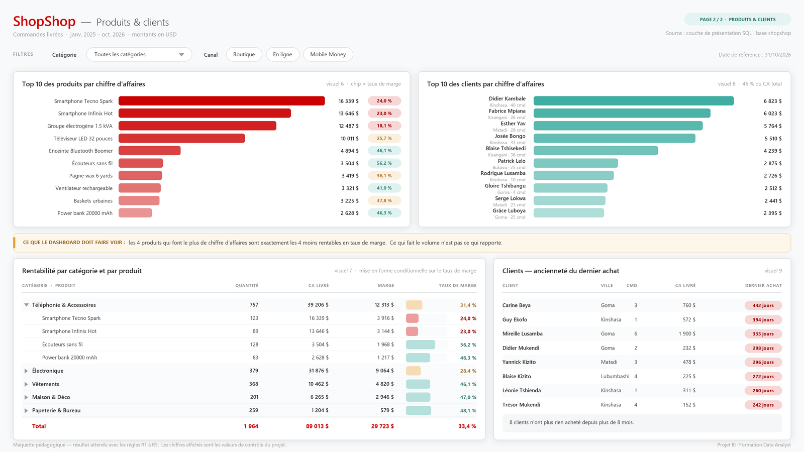

# 📕 Corrigé formateur — Projet BI ShopShop (version simplifiée)

> **Document formateur.** Ne pas distribuer avant la correction.

## Les fichiers du corrigé

| Fichier | Contenu |
|---|---|
| **`CORRIGE.md`** ← vous êtes ici | le déroulé de correction, étape par étape |
| `solution_couche_presentation.sql` | les 4 vues attendues, commentées |
| `solution_mesures_dax.md` | le modèle, les 13 mesures, les bonus |
| `valeurs_de_controle.txt` | **tous** les chiffres, à garder ouvert pendant la correction |
| `maquettes_src/` | le générateur Python des 2 maquettes — à relancer si le jeu de données change ([mode d'emploi](maquettes_src/README.md)) |

**Ordre d'exécution si vous montez la solution de référence :**
`01` → `02` → `05` → `solution_couche_presentation.sql`.
(`03_vues_du_stagiaire.sql` est indépendant : c'est le matériel d'audit.)

---

## 0. Les quatre chiffres à avoir en tête

| | | Ce que ça signale |
|---|---|---|
| **89 012,69** | ✅ le bon CA | tout est en ordre |
| 94 165,80 | ❌ | l'étudiant a sommé `commandes.montant` (anomalie 1 ratée) |
| 87 028,19 | ❌ | `COALESCE` oublié (anomalie 2 ratée) |
| 100 787,40 | ❌ | filtre `livrée` absent (règle R2 ratée) |

En trente secondes, le premier KPI du dashboard vous dit où l'étudiant s'est arrêté.
Commencez toujours par là.

Les autres repères : marge **29 722,69** · taux de marge **33,39 %** ·
648 commandes dont **554 livrées** · taux d'annulation **10,96 %** · panier moyen
**161,25** · **7** villes · **1 964** articles.

---

## 1. Étape 2 — L'audit qualité (5 points)

**1 point par anomalie**, et le point ne se donne que si la colonne « décision » du
tableau est remplie. Un constat seul vaut 0,5.

| # | Anomalie | Le chiffre attendu | La décision attendue |
|---|---|---|---|
| **1** | 5 totaux de caisse faux | écart **+5 153,11** USD, commande **517** à +4 941 | le CA vient de `lignes_commande` (R1) ; les 5 commandes sont **signalées** à la comptabilité, pas corrigées par l'analyste |
| **2** | 32 remises à `NULL` (34 tous statuts) | **1 984,50** USD évaporés | `NULL` traité comme 0, parce que la caisse ne remplit la case que si une remise est accordée |
| **3** | 18 orthographes de ville | **7** villes réelles | nettoyage `INITCAP(TRIM())` **dans la base** ; recommandation : liste déroulante en caisse |
| **4** | 2 produits jamais vendus, 14 clients sans CA | 2 et 14 | `LEFT JOIN`, on garde tout le monde avec des zéros |
| **5** | 2 commandes sans ligne (#119, #402) | 554 livrées vs **552** avec contenu | choix explicite du dénominateur du panier moyen |

### Les pièges de correction

- **Anomalie 4 :** « 11 clients sans aucune commande » et « 14 clients sans commande
  **livrée** » sont deux réponses différentes, toutes les deux justes. Le chiffre qui
  compte pour le dashboard est **14** (ce sont eux qui apparaissent à 0 USD). Ne pas
  sanctionner l'étudiant qui donne 11, mais lui faire remarquer la nuance : trois
  clients ont commandé puis tout annulé.
- **Anomalie 5 :** les deux dénominateurs (554 → 160,67 / 552 → 161,25) sont
  acceptés. Ce qui ne l'est pas : afficher un chiffre sans avoir tranché, ou afficher
  l'un dans le dashboard et l'autre dans la note.
- **Anomalie 1 :** l'étudiant qui « corrige » `commandes.montant` dans la base a
  dépassé son périmètre. Le lui dire : on ne modifie pas des écritures comptables
  sans mandat, on les signale.

### L'audit des 3 vues de Jonas

| Vue | Ce qui est faux | Preuve chiffrée |
|---|---|---|
| `v_rentabilite_produits` | ① `remise_appliquee` sans `COALESCE` → les lignes à `NULL` sortent du `SUM` ② `JOIN` au lieu de `LEFT JOIN` depuis `produits` → les 2 produits jamais vendus sont **absents**, pas à zéro | annonce **87 028,19** et **23 lignes** au lieu de 25 |
| `v_evolution_ventes_mensuelles` | ① le CA vient de `commandes.montant` (viole R1) ② `annee` et `mois` sont deux entiers, pas une date → impossible à relier à un calendrier ③ `ORDER BY` dans une vue : inutile, Power BI l'ignore | annonce **94 165,80** |
| `v_segmentation_clients` | ① `JOIN` au lieu de `LEFT JOIN` → **67** clients au lieu de 81 ② `CURRENT_DATE` → les chiffres bougent chaque matin (viole R5) ③ montant depuis `commandes.montant` | 67 lignes, et une récence différente à chaque exécution |

> **Le message pédagogique à faire sortir en restitution :** ces trois vues sont
> *bien écrites*. En-tête de doc, `snake_case`, préfixe `v_`, indentation propre.
> Elles passent une revue de code superficielle sans problème. Ce qui les rend
> fausses n'est pas de la syntaxe, c'est du **raisonnement** — et ça, aucun linter ne
> l'attrape. D'où l'audit.

---

## 2. Étape 3 — La couche de présentation (5 points)

Solution de référence : [`solution_couche_presentation.sql`](solution_couche_presentation.sql).

| Ce qu'on vérifie | Points |
|---|---|
| `v_dim_client` : 81 lignes, **7** villes distinctes | 1 |
| `v_fait_commandes` : 648 lignes, **sans** la colonne `montant` | 1 |
| `v_fait_ventes` : 1 289 lignes, `COALESCE` présent, **aucun filtre sur le statut** | 2 |
| Les 3 vues ont l'en-tête de documentation standard | 1 |

### Les deux fautes graves de cette étape

1. **Filtrer `statut = 'livrée'` dans `v_fait_ventes`.** C'est l'erreur la plus
   fréquente et la plus coûteuse : le taux d'annulation tombe à 0 %, et l'analyse des
   annulations devient impossible pour toujours. Le périmètre est une question de
   **mesure**, pas de **structure**.
   *Détection immédiate :* `v_fait_ventes` a moins de 1 289 lignes.

2. **Pré-calculer un taux de marge en SQL.** La matrice de la page 2 affichera des
   pourcentages absurdes par catégorie. On additionne les montants, **puis** on
   divise — toujours en DAX.

### Les variantes à accepter

- Garder `categories` comme table séparée au lieu de l'aplatir dans `v_dim_produit` :
  ça marche, ça fait juste une relation de plus. Le signaler, ne pas sanctionner.
- Nettoyer la ville dans Power Query plutôt que dans la vue : même résultat, moins
  réutilisable. Faire verbaliser pourquoi la base est préférable (l'export Excel de
  la compta retomberait sur 18 orthographes).
- Une vue `v_dim_date` écrite par l'étudiant au lieu de celle fournie : bonus.

---

## 3. Étape 4 — Modèle et mesures (5 points)

Détail complet : [`solution_mesures_dax.md`](solution_mesures_dax.md).

| Ce qu'on vérifie | Points |
|---|---|
| 4 relations, toutes en 1:* et en filtre simple | 1,5 |
| Calendrier marqué comme table de dates + `mois_annee` trié par `mois_tri` | 1 |
| Les mesures d'argent et de volume tombent sur les valeurs de contrôle | 1,5 |
| `Taux de marge` et `Taux d'annulation` calculés comme un rapport de totaux | 0,5 |
| Formatage : pas de `89012,6899999` à l'écran | 0,5 |

**Le test en 30 secondes :** poser une carte, y faire défiler les mesures, comparer à
la liste de `valeurs_de_controle.txt`. Dix nombres, dix vérifications.

---

## 4. Étape 5 — Le dashboard (3 points)

Le rendu attendu, à garder ouvert pendant la correction :

> Ces maquettes sont **distribuées aux étudiants** (README et brief). Elles ne sont
> pas un modèle à reproduire au pixel : on note les chiffres et la lisibilité, pas la
> ressemblance. Un étudiant qui place ses visuels autrement mais tombe sur les bonnes
> valeurs a tous les points.

| Ce qu'on vérifie | Points |
|---|---|
| Page 1 : les 5 visuels, présents et justes | 1 |
| Page 2 : les 4 visuels, présents et justes | 1 |
| Lisibilité : titres, périmètre affiché, segments fonctionnels, libellés en clair | 1 |

**Les contrôles visuels qui vont vite :**

| Regarder | Attendu | Si c'est faux |
|---|---|---|
| Le graphique « CA par ville » | **7 barres** | l'anomalie 3 n'est pas traitée |
| L'axe de la courbe mensuelle | commence à **janv. 2025** | `mois_annee` pas trié par `mois_tri` |
| La courbe N-1 | vide sur 2025, renseignée sur 2026 | calendrier non marqué comme table de dates |
| Le pic de la courbe | **août 2026, 7 956,65** | |
| Le top 10 produits | Tecno Spark en tête, **16 339,05** | |
| Le taux de marge par catégorie | Papeterie **48 %**, Téléphonie **31 %** | si tout est proche de 33 %, c'est une moyenne de pourcentages |

---

## 5. Étape 6 — La restitution (2 points)

### Les réponses attendues

**Q1 — Combien on vend, est-ce que ça monte ?**
89 012,69 USD de CA livré, 29 722,69 de marge, 33,39 % de taux de marge, sur
554 commandes livrées (panier moyen 161,25). À période égale janvier–octobre, le CA
passe de 36 796,97 à 45 248,63 USD, soit **+22,97 %**. Pic en août 2026 (7 956,65),
creux en novembre 2025 (2 160,34).

> 🏅 **Bonus explicite** pour l'étudiant qui signale que comparer les deux années
> entières (+3,4 %) est trompeur, parce que 2026 s'arrête au 31 octobre. C'est
> exactement le genre d'erreur qui fait prendre une mauvaise décision en comité.

**Q2 — Qu'est-ce qui nous fait gagner de l'argent ?**
La Téléphonie fait 44 % du CA (39 206 USD) et la plus grosse marge en valeur
(12 313 USD), mais le **moins bon taux** (31,4 %). La Papeterie fait le plus petit CA
(1 204 USD) et le **meilleur taux** (48,1 %). Côté canal : Boutique 45 %, En ligne 34 %,
Mobile Money 21 %.

> La réponse attendue n'est pas le classement, c'est la **tension** : ce qui fait le
> volume n'est pas ce qui rapporte le plus par dollar vendu. Les 4 produits qui font
> le plus de chiffre d'affaires sont exactement les 4 moins rentables en taux de marge.

**Q3 — Qui sont nos clients, lesquels perd-on ?**
Les 10 premiers clients pèsent 41 308,94 USD, soit **46,4 %** du CA — une
concentration élevée, donc un risque. Kinshasa représente 47 % du CA. 14 clients sur
81 n'ont jamais généré de CA. Et des clients à fort historique sont partis : Carine
Beya (442 jours), Guy Ekofo (394 jours).

### Les recommandations attendues (2 sur ce type)

| Thème | Formulation acceptable |
|---|---|
| Mix produit | « Mettre en avant la Papeterie et les accessoires : 48 % de taux de marge contre 31 % pour la téléphonie, sur seulement 1 204 USD de CA aujourd'hui » |
| Annulations | « Rappeler les commandes `en_cours` de plus de 7 jours : 71 annulations sur 22 mois, 11 % du volume, avec un pic à 31 % en février 2025 » |
| Rétention | « Campagne de réactivation sur les clients inactifs depuis plus de 180 jours, dont Carine Beya et Guy Ekofo qui faisaient partie des acheteurs réguliers » |
| Concentration | « Diversifier le portefeuille : 46 % du CA tient sur 10 clients » |
| Qualité à la source | « Mettre une liste déroulante de villes dans le logiciel de caisse, et bloquer la saisie d'un total de commande sans ligne de détail » |
| Remises | « Encadrer les remises : une ligne a été vendue à perte (remise de 110 USD sur un produit qui en marge 80) » |

Refuser les recommandations sans chiffre et sans destinataire (« améliorer la
satisfaction client »).

---

## 6. La grille — 20 points

| Bloc | Critère | Pts |
|---|---|---|
| **Audit** | 5 anomalies trouvées, chiffrées, **et décidées** (1 pt chacune) | 5 |
| **SQL** | `v_dim_client` (7 villes) | 1 |
| | `v_fait_commandes` (648, sans `montant`) | 1 |
| | `v_fait_ventes` (1 289, `COALESCE`, pas de filtre statut) | 2 |
| | En-têtes de documentation sur les 3 vues | 1 |
| **Power BI** | 4 relations correctes | 1,5 |
| | Table de dates marquée + tri des mois | 1 |
| | Mesures conformes aux valeurs de contrôle | 1,5 |
| | Ratios calculés comme rapports de totaux + formatage | 1 |
| **Dashboard** | Page 1 (5 visuels) | 1 |
| | Page 2 (4 visuels) | 1 |
| | Lisibilité et interactivité | 1 |
| **Restitution** | 3 questions répondues avec des chiffres | 1 |
| | 2 recommandations actionnables | 1 |
| | **Total** | **20** |

**Barème :** < 10 à reprendre · 10–13 acquis partiel · 14–16 bon niveau ·
≥ 17 niveau professionnel.

### Les pénalités

| Faute | Pénalité |
|---|---|
| CA calculé depuis `commandes.montant` | **le bloc Power BI à 0** (5 pts) |
| Taux de marge en moyenne de pourcentages | bloc Power BI ÷ 2 |
| Filtre `livrée` figé dans `v_fait_ventes` | −1 sur le bloc SQL |
| Anomalie constatée mais non décidée | −0,5 par anomalie |
| Récence calculée avec `TODAY()` | −0,5 |

### Ce qui mérite un bonus (jusqu'à +2, plafonné à 20)

- Avoir repéré le piège de la comparaison annuelle sur 2026 incomplète
- Avoir trouvé le doublon client (#3 / #81) ou la ligne à marge négative (#340)
- Une jauge d'objectif, un nuage de points produits, ou une segmentation RFM
- Une page « Qualité des données » qui affiche les anomalies en permanence
- Une section « limites de ce travail » honnête dans la note de mission

---

## 7. Les erreurs à attendre, par ordre de fréquence

1. **Importer les tables brutes en plus des vues.** L'étudiant coche tout dans le
   Navigateur, puis utilise `commandes[montant]` par réflexe. → KPI à 94 165,80.
   *Remède :* faire recommencer l'import en ne cochant que les 5 vues.
2. **Oublier de marquer le calendrier comme table de dates.** `CA livré N-1` reste
   désespérément vide et l'étudiant cherche dans la formule DAX.
3. **Filtrer `livrée` trop tôt**, dans la vue SQL. Taux d'annulation à 0 %.
4. **Mois triés alphabétiquement.** La courbe commence en août. Très visible, très
   facile à corriger : `Trier par colonne`.
5. **Moyenne de pourcentages** pour le taux de marge par catégorie.
6. **Noms techniques affichés** dans les visuels (`ca_ligne`, `nom_produit`).
7. **Note de mission qui raconte la méthode** au lieu des résultats. Rappeler que le
   destinataire est la direction commerciale, pas le formateur.

---

## 8. Déroulé de restitution conseillé (30 minutes)

| Durée | Séquence |
|---|---|
| 3 min | Afficher les trois nombres : 94 165,80 / 87 028,19 / 89 012,69. Demander lequel est le bon, et pourquoi. |
| 5 min | Reprendre les 5 anomalies. Pour chacune, demander la **décision**, pas le constat. |
| 5 min | Les vues de Jonas. Insister : elles sont bien écrites. Ce n'est pas un problème de syntaxe. |
| 7 min | L'architecture. Montrer côte à côte la mesure DAX avec et sans la couche (voir `solution_mesures_dax.md`). Poser la question d'entretien : « où mettez-vous votre logique métier ? » |
| 5 min | Deux ou trois dashboards d'étudiants au vidéoprojecteur. Vérifier en direct : 7 barres pour les villes, axe qui commence en janvier. |
| 5 min | Le piège de la comparaison 2025/2026. Montrer +3,4 % puis +22,97 %. Demander laquelle on présente en comité de direction. |

---

## 9. Ce qui a été simplifié par rapport à la version d'origine

Pour les formateurs qui connaissent `Projet_BI_ShopShop_Desktop`. **La base, les
données et tous les chiffres sont identiques** : les deux versions sont corrigeables
avec les mêmes valeurs de référence.

| | Version d'origine | Cette version |
|---|---|---|
| Durée | 12–16 h | 8 h |
| Architecture | approche A obligatoire + approche B en bonus, avec justification écrite notée | une seule approche, imposée et expliquée |
| Anomalies | 9, à trouver sans aide | 5, chacune avec une requête guidée |
| SQL à écrire | 3 vues réparées + calendrier + 5 vues de présentation | 3 vues (calendrier fourni, 1 exemple donné) |
| Vues de Jonas | à auditer **et** à réparer | à auditer seulement — on les remplace, on ne les rafistole pas |
| Dashboard | 14 visuels, 3 pages | 9 visuels, 2 pages |
| DAX | mesures à inventer, `SUMX` + `RELATED` | 13 mesures données avec leur valeur de contrôle |
| Rendus | 6 fichiers | 3 fichiers |
| Notation | 100 points, 15 critères | 20 points, 5 blocs |

**Ce qui a été retiré du tronc commun est devenu bonus**, rien n'est perdu : approche
comparative, nuage de points, RFM, doublon client, ligne à marge négative, jauge
d'objectif, page qualité.

**Les deux partis pris pédagogiques à connaître :**

1. **Une seule architecture, et c'est celle de l'entreprise.** Arbitrer entre deux
   approches est une excellente question d'architecte et une mauvaise question de
   débutant : ça double le travail et laisse l'étudiant sans moyen de savoir laquelle
   il a ratée. On impose la couche SQL — qui est aussi la bonne réponse en
   entreprise — et on **explique pourquoi**, ce qui est l'essentiel de l'apprentissage.

2. **Chaque étape a une valeur de contrôle.** C'est la simplification la plus
   efficace du lot : un débutant qui ne sait pas s'il est sur la bonne voie bloque
   deux heures sur une erreur de syntaxe. Avec un nombre à retrouver à chaque étape,
   il se corrige tout seul — et il apprend au passage le réflexe professionnel de
   vérifier ses chiffres à chaque transformation.

---

*Corrigé formateur · Projet BI ShopShop · Formation Data Analyst*
